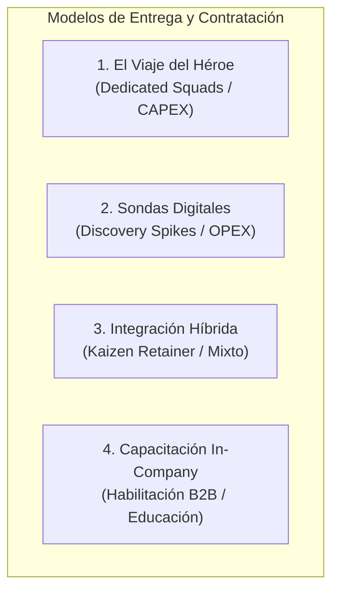

# 01. Contexto Comercial y Comprensión del Negocio

> **Proyecto:** Boutique Digital — Consultoría de Software & Operaciones  
> **Repositorio Matriz Upstream:** [Thinking-as-a-Service](https://github.com/willkwolf/Thinking-as-a-Service)  
> **Especificación Canónica del Dominio (SSOT):** `SPEC-TRAINING-AIA-AGENTIC-2026`  
> **Fecha de Auditoría:** Noviembre 2026  
> **Enfoque Metodológico:** Mobile-First Advertising Copywriting, Anti-Slop Design Policy & Human-in-the-Loop Governance  

---

## 1. Identidad, Posicionamiento y Misión de Marca

**Boutique Digital** opera como el brazo formativo y de desarrollo de ingeniería de software y automatizaciones prácticas para **Empresas Livianas** (*Lightweight Enterprises*): agencias digitales, consultoras de servicios profesionales y empresas tecnológicas de rápido crecimiento.

### 1.1 Estética y Tono de Comunicación
- **Estilo Visual:** Crema Editorial / Lujo Industrial (*Editorial Cream / Industrial Luxury*).
- **Densidad de Señal:** Alta sobriedad conceptual, rigor de ingeniería, cero hipérbole publicitaria (*anti-hype*).
- **Privacidad Estricta:** Cero rastreo (*Zero-Tracking*), sin scripts analíticos externos ni telemetría invasiva (Ley 1581 de 2012).
- **Principio Invariable de Copy:** *"Clarity over Cleverness"* y *"Claim-Proof Invariance"*. Toda afirmación comercial debe estar respaldada por un mecanismo técnico u operativo tangible.

---

## 2. Propuesta de Valor Central

> **"Ingeniería de software y optimización de flujos para agencias que escalan sin inflar su nómina."**

Ayudamos a firmas de servicios y agencias digitales a resolver cuellos de botella operativos mediante tres sombrillas de ingeniería:
1. **Desarrollo de Software a la Medida:** Aplicaciones web/móvil, arquitecturas de microservicios e integraciones API deterministas sin dependencia de plataformas cerradas ni deuda técnica.
2. **Pipelines de Datos & Automatización Operacional:** Flujos de datos seguros, estructurados y orquestación de agentes de IA supervisados bajo gobernanza *Human-in-the-Loop* (HitL).
3. **Generación de Conocimiento & Capacitación In-Company:** Formación ejecutiva para directores de área, gerentes de operaciones y líderes técnicos en supervisión y gobierno agéntico.

---

## 3. Público Objetivo y Segmentación de Clientes

| Segmento / Persona | Rol Típico | Dolores Operativos Principales | Disparador de Decisión |
|---|---|---|---|
| **Digital Project / Product Manager** | Lidera squads y entregables para clientes de agencia. | Retrasos en entregas, cuellos de botella manuales en reporting, inconsistencia de datos entre herramientas. | Reducir horas hombre no facturables y automatizar flujos repetitivos con fiabilidad. |
| **Director de Operaciones / COO** | Responsable de márgenes brutos y capacidad instalada. | Necesidad de escalar capacidad de entrega sin multiplicar costos fijos de nómina ni sufrir desgaste del equipo (*burnout*). | Proteger márgenes operativos mediante flujos y agentes que incrementen el *throughput* sin inflar el headcount. |
| **Tech Lead / VP of Engineering** | Custodio de la arquitectura y la deuda técnica. | Miedo a adoptar "soluciones mágicas de IA" que generen alucinaciones, brechas de seguridad o código espagueti inmantecible. | Sistemas idempotentes, con arneses de prueba controlados, sandbox contextual y estricto código soberano (100% código propio en Git). |
| **Founder / CEO de Agencia** | Dueño de agencia de 10 a 50 colaboradores. | Competencia voraz de precios y lentitud en comercializar capacidades avanzadas de IA. | Alianza estratégica con una boutique técnica que valide hipótesis con velocidad y ejecute con rigor. |

---

## 4. Portafolio de Soluciones y Modelos de Entrega

El modelo comercial de Boutique Digital se articula bajo tres analogías visuales e industriales:

1. **El Viaje del Héroe (Dedicated Engineering Squads · Predominio CAPEX):** Acompañamiento integral desde la línea base operativa hasta la autonomía tecnológica, integrando una célula ágil dedicada que asume propiedad compartida de los hitos del cliente.
2. **Sondas Digitales (Fixed-Scope Discovery & Spikes · Predominio OPEX):** Sprints acotados de 1 a 2 semanas para poner a prueba hipótesis técnicas o modelos de frontera de IA en entornos controlados, produciendo evidencia empírica antes de comprometer capital.
3. **Integración Híbrida (Strategic Kaizen Retainer · Estructura Mixta):** Doble carril sincronizado que mantiene un roadmap troncal de ingeniería continua combinado con sondas periféricas bajo compuertas de gobernanza (*Quality Gates* / Test Ácido).
4. **Habilitación In-Company (Programa Ejecutivo de Supervisión Agéntica):** Programa intensivo para formar el juicio técnico de líderes intermedios en diseño, especificación de contratos y evaluación de flujos agénticos.

---

## 5. Recorrido Comercial y Embudo de Conversión

- **Tráfico:** Orgánico, referencias profesionales B2B y campañas focalizadas en tomadores de decisión.
- **Micro-Conversión 1 (Educación B2B):** Formulario o solicitud de cotización para capacitación corporativa vía WhatsApp institucional (`+573002976815`).
- **Macro-Conversión 2 (Servicios de Ingeniería):** Enlace directo de consulta técnica con el equipo de ingeniería y operaciones para discutir alcance y viabilidad arquitectónica sin intermediarios comerciales genéricos.
- **Política de Fricción Cero:** Sin formularios interminables ni muros de captación que filtren correos para spam; contacto directo de un clic a canal encriptado de WhatsApp Business.
