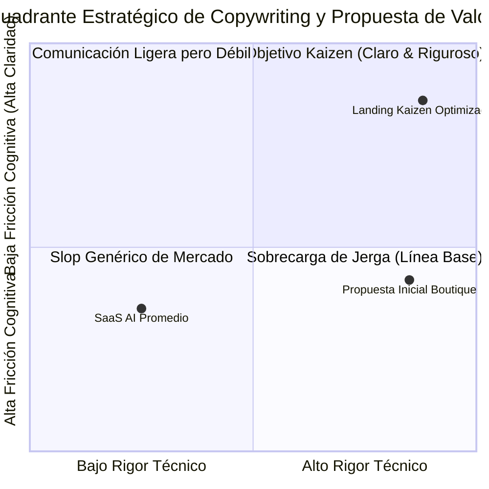

# 02. Auditoría FODA / SWOT y Matriz de Impacto Cruzado

> **Ecosistema:** Boutique Digital — Consultoría de Software & Operaciones  
> **Área Auditada:** Copywriting Publicitario, Posicionamiento y Propuesta de Valor en Superficie Web  
> **Metodología:** Análisis Estratégico FODA + Matriz de Impacto Cruzado (FO, FA, DO, DA)  

---

## 1. Diagnóstico FODA (SWOT)

### 1.1 Fortalezas (Strengths)
1. **F1 — Identidad Editorial Distintiva:** Estética Crema Editorial / Lujo Industrial con cero clichés visuales (sin degradados púrpuras, sin orbes de neón, sin tipografías sintéticas comunes).
2. **F2 — Rigor de Ingeniería y Fundamentos Epistemológicos:** Respaldo canónico en marcos sólidos (Teoría de Restricciones, Ley de Little, Ley de Conway, Test Ácido) a través del hub upstream *Thinking-as-a-Service*.
3. **F3 — Transparencia Operacional y Modelos de Entrega Concretos:** Estructuración de modelos de contratación reconocibles por la industria (Staff Augmentation, Fixed Discovery, Strategic Retainer) presentados con analogías claras (Viaje del Héroe, Sondas Digitales, Integración Híbrida).
4. **F4 — Privacidad y Cumplimiento de Cero Rastreo:** Cero scripts de terceros, respeto absoluto a la Ley 1581 de 2012 y arquitectura hermética sin enlaces rotos ni dependencias de telemetría invasiva.
5. **F5 — Arquitectura de Botones Disciplinada:** Solamente dos llamadas a la acción (CTAs) operacionales activas en la página para evitar la dispersión del usuario.

### 1.2 Oportunidades (Opportunities)
1. **O1 — Cansancio del Mercado frente al "AI Slop":** El mercado B2B está saturado de herramientas genéricas de IA que prometen magia y entregan deuda técnica; existe una alta receptividad a discursos sobrios que enfaticen gobernanza y pruebas controladas.
2. **O2 — Necesidad de Escalamiento Operativo sin Headcount:** Agencias y firmas de servicios enfrentan presión en márgenes brutos, buscando optimizar procesos críticos sin incurrir en contratación masiva.
3. **O3 — Dominio Móvil en Tomadores de Decisión:** Founders y directores de operaciones consumen contenido profesional y evalúan soluciones en dispositivos móviles durante tiempos muertos y desplazamientos.
4. **O4 — Demanda Corporativa de Capacitación Ejecutiva:** Brecha creciente en mandos medios (managers, PMs, tech leads) que carecen de marcos para evaluar y auditar agentes inteligentes sin caer en trampas de hype.

### 1.3 Debilidades (Weaknesses - Detectadas en Línea Base)
1. **D1 — Carga Cognitiva Elevada en la Apertura Móvil:** El subtítulo inicial acumulaba 32 palabras densas con exceso de conceptos técnicos yuxtapuestos, ralentizando la asimilación del valor en los primeros 3 segundos.
2. **D2 — Prolijidad Narrativa en los Modelos de Entrega:** Los bloques narrativos de las tres analogías superaban las 100 palabras cada uno, obligando a desplazamientos prolongados en pantallas de 360px y 320px antes de alcanzar los puntos clave de gobernanza.
3. **D3 — Mismatch de Accesibilidad WCAG 2.5.3:** Discrepancia tipográfica entre el texto visible del botón (`Contactar Equipo por WhatsApp`) y el atributo accesible `aria-label` (`Contactar al equipo...`).
4. **D4 — Desbordamiento Horizontal Residual en Pantallas Estrechas (320px):** Espaciados y rellenos fijos que provocaban un desbordamiento de 11px en dispositivos con ancho de 320px.

### 1.4 Amenazas (Threats)
1. **A1 — Percepción de "Consultoría Tradicional Lenta":** Riesgo de que audiencias no técnicas confundan sobriedad con lentitud o complejidad burocrática.
2. **A2 — Banalización del Término "Agentes de IA":** La proliferación de agentes de juguete o chatbots mal implementados genera escepticismo inicial en compradores corporativos.
3. **A3 — Resistencia al Cambio en Mandos Medios:** Temor de los mandos medios a que la automatización o los agentes supervisados reemplacen puestos de trabajo en lugar de amplificar la capacidad instalada.

---

## 2. Matriz de Impacto Cruzado (Cross-Impact Matrix)

| Cruce | Evaluación | Resultado esperado |
|---|---|---|
| **Fortalezas + Oportunidades (FO)** | **Cómo aprovechar las fortalezas:** Posicionar la sobriedad editorial (F1) y el rigor de ingeniería (F2) como el antídoto contra el AI Slop (O1). Presentar las 3 analogías operativas con 2 CTAs únicos (F3, F5) para tomadores de decisión en móviles (O2, O3). | **Potenciar el valor comercial:** Captación de agencias y líderes técnicos desilusionados del hype, comunicando protección de márgenes en menos de 7 segundos con conversión directa a WhatsApp. |
| **Fortalezas + Amenazas (FA)** | **Cómo proteger las fortalezas:** Respaldar cada capacidad con marcos formales (Test Ácido, arneses de prueba, contratos de software) frente a la banalización de agentes (A2). Enfocar la capacitación B2B en la supervisión humana (*Human-in-the-Loop*) contra el temor al reemplazo laboral (A3). | **Reducir riesgos de percepción:** Diferenciación categórica frente a soluciones mágicas inestables, consolidando la reputación de Boutique Digital como socio técnico confiable. |
| **Debilidades + Oportunidades (DO)** | **Cómo corregir debilidades:** Reducir drásticamente la sobrecarga de texto en el hero (D1) y las narrativas de los showcases (D2) en un 50% para aprovechar la audiencia móvil (O3). Resolver el desbordamiento horizontal en 320px (D4). | **Mejorar comprensión y conversión:** Comprensión de la propuesta en los primeros 3 segundos, facilitando el escaneo visual y la interacción fluida en el 100% de dispositivos móviles. |
| **Debilidades + Amenazas (DA)** | **Cómo contener riesgos:** Corregir accesibilidad WCAG 2.5.3 (D3) y eliminar preámbulos de "cuarta pared" (D2) para no transmitir lentitud burocrática ni complejidad artificial (A1, A2). | **Evitar fricciones y pérdida de confianza:** Recorrido limpio, accesible y libre de barreras técnicas que brinda acceso directo al equipo de ingeniería sin intermediación. |

---

## 3. Nota sobre Metodología ODOF en el Repositorio

Se realizó una inspección exhaustiva de la documentación técnica y especificaciones canónicas (`SPEC-TRAINING-AIA-AGENTIC-2026`, `PROJECT.md`, `AGENTS.md`). No existe en el proyecto una metodología interna denominada **ODOF**. Por tanto, este diagnóstico adopta el marco estándar canónico **FODA / SWOT con Matriz de Impacto Cruzado (FO, FA, DO, DA)**, garantizando rigor metodológico sin invención de marcos no documentados.
