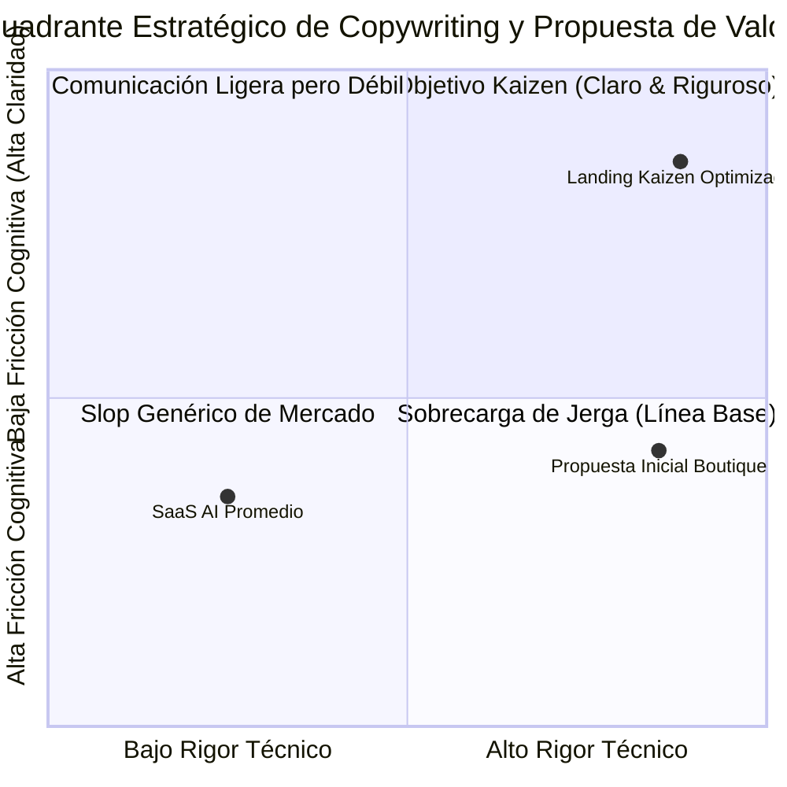

# 02. Auditoría FODA / SWOT y Matriz de Impacto Cruzado

> **Ecosistema:** Boutique Digital — Consultoría de Software & Operaciones  
> **Área Auditada:** Copywriting Publicitario, Posicionamiento y Propuesta de Valor en Superficie Web  
> **Metodología:** Análisis Estratégico FODA + Matriz de Impacto Cruzado (FO, FA, DO, DA)  

---

## 1. Diagnóstico FODA (SWOT)

### 1.1 Fortalezas (Strengths)
1. **F1 — Identidad Editorial Distintiva:** Estética Crema Editorial / Lujo Industrial con cero clichés visuales (sin degradados púrpuras, sin orbes de neón, sin tipografías sintéticas comunes).
2. **F2 — Rigor de Ingeniería y Fundamentos Epistemológicos:** Respaldo canónico en marcos sólidos (Teoría de Restricciones, Ley de Little, Ley de Conway, Test Ácido) a través del hub upstream *Thinking-as-a-Service*.
3. **F3 — Transparencia Operacional y Modelos de Entrega Concretos:** Estructuración de modelos de contratación reconocibles por la industria (Staff Augmentation, Fixed Discovery, Strategic Retainer) presentados con analogías claras (Viaje del Héroe, Sondas Digitales, Integración Híbrida).
4. **F4 — Privacidad y Cumplimiento de Cero Rastreo:** Cero scripts de terceros, respeto absoluto a la Ley 1581 de 2012 y arquitectura hermética sin enlaces rotos ni dependencias de telemetría invasiva.
5. **F5 — Arquitectura de Botones Disciplinada:** Solamente dos llamadas a la acción (CTAs) operacionales activas en la página para evitar la dispersión del usuario.

### 1.2 Oportunidades (Opportunities)
1. **O1 — Cansancio del Mercado frente al "AI Slop":** El mercado B2B está saturado de herramientas genéricas de IA que prometen magia y entregan deuda técnica; existe una alta receptividad a discursos sobrios que enfaticen gobernanza y pruebas controladas.
2. **O2 — Necesidad de Escalamiento Operativo sin Headcount:** Agencias y firmas de servicios enfrentan presión en márgenes brutos, buscando optimizar procesos críticos sin incurrir en contratación masiva.
3. **O3 — Dominio Móvil en Tomadores de Decisión:** Founders y directores de operaciones consumen contenido profesional y evalúan soluciones en dispositivos móviles durante tiempos muertos y desplazamientos.
4. **O4 — Demanda Corporativa de Capacitación Ejecutiva:** Brecha creciente en mandos medios (managers, PMs, tech leads) que carecen de marcos para evaluar y auditar agentes inteligentes sin caer en trampas de hype.

### 1.3 Debilidades (Weaknesses - Detectadas en Línea Base)
1. **D1 — Carga Cognitiva Elevada en la Apertura Móvil:** El subtítulo inicial acumulaba 32 palabras densas con exceso de conceptos técnicos yuxtapuestos, ralentizando la asimilación del valor en los primeros 3 segundos.
2. **D2 — Prolijidad Narrativa en los Modelos de Entrega:** Los bloques narrativos de las tres analogías superaban las 100 palabras cada uno, obligando a desplazamientos prolongados en pantallas de 360px y 320px antes de alcanzar los puntos clave de gobernanza.
3. **D3 — Mismatch de Accesibilidad WCAG 2.5.3:** Discrepancia tipográfica entre el texto visible del botón (`Contactar Equipo por WhatsApp`) y el atributo accesible `aria-label` (`Contactar al equipo...`).
4. **D4 — Desbordamiento Horizontal Residual en Pantallas Estrechas (320px):** Espaciados y rellenos fijos que provocaban un desbordamiento de 11px en dispositivos con ancho de 320px.

### 1.4 Amenazas (Threats)
1. **A1 — Percepción de "Consultoría Tradicional Lenta":** Riesgo de que audiencias no técnicas confundan sobriedad con lentitud o complejidad burocrática.
2. **A2 — Banalización del Término "Agentes de IA":** La proliferación de agentes de juguete o chatbots mal implementados genera escepticismo inicial en compradores corporativos.
3. **A3 — Resistencia al Cambio en Mandos Medios:** Temor de los mandos medios a que la automatización o los agentes supervisados reemplacen puestos de trabajo en lugar de amplificar la capacidad instalada.

---

## 2. Matriz de Impacto Cruzado (Cross-Impact Matrix)

| Estrategia | Oportunidades (O) | Amenazas (A) |
|---|---|---|
| **Fortalezas (F)** | **Estrategias FO (Maxi-Maxi):** • **FO-1 (F1+F2 con O1):** Posicionar la sobriedad editorial y el rigor técnico como el antídoto definitivo frente al "AI Slop", capturando a compradores B2B decepcionados por soluciones mágicas. • **FO-2 (F3+F5 con O2+O3):** Diseñar un recorrido móvil ultralimpio donde las tres analogías de entrega comuniquen la protección de márgenes en menos de 7 segundos con conversión directa a WhatsApp. | **Estrategias FA (Maxi-Mini):** • **FA-1 (F2+F4 con A2):** Demostrar con evidencia empírica (Test Ácido, arneses de evaluación, contratos de software) que nuestros agentes son sistemas supervisados e idempotentes, neutralizando el escepticismo del mercado. • **FA-2 (F2+F3 con A3):** Enfocar el copy de la capacitación B2B en "dotar de criterio y juicio directivo al humano" (*Human-in-the-Loop*), erradicando el miedo al reemplazo laboral. |
| **Debilidades (D)** | **Estrategias DO (Mini-Maxi):** • **DO-1 (D1+D2 con O3):** Reducir drásticamente la extensión del subtítulo y las narrativas de los showcases (reducción del 50% en palabras) para lograr comprensión en 3 segundos en pantallas móviles. • **DO-2 (D4 con O3):** Aplicar reglas de layout responsivo disciplinadas para pantallas de 320px a 430px, asegurando navegación sin fricción en el 100% de dispositivos. | **Estrategias DA (Mini-Mini):** • **DA-1 (D1+D3 con A1):** Corregir accesibilidad WCAG 2.5.3 y sintetizar la propuesta de valor para comunicar agilidad, viabilidad rápida y contacto directo con ingenieros en lugar de procesos pesados. • **DA-2 (D2 con A2):** Reemplazar cualquier texto explicativo de "cuarta pared" por especificaciones directas de gobernanza, auditoría y mitigación de deuda técnica. |
