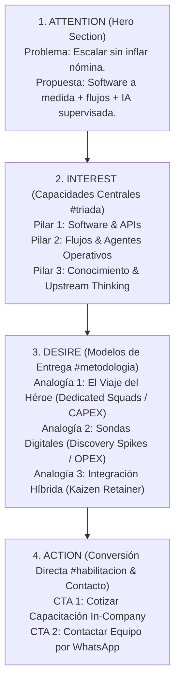

# 03. Auditoría de Experiencia Móvil (Mobile-First UX) y Carga Cognitiva

> **Enfoque de Auditoría:** Mobile-First Responsive Evaluation & Cognitive Load Profiling  
> **Dispositivos y Resoluciones Auditadas:**  
> 1. `android-360` (360 × 800 px) — Dispositivo estándar Android (mercado masivo LATAM / global)  
> 2. `iphone-390` (390 × 844 px) — Dispositivo estándar iOS (iPhone 12/13/14/15)  
> 3. `large-430` (430 × 932 px) — Gama alta y pantallas grandes (iPhone Pro Max / Plus)  
> 4. `narrow-320` (320 × 640 px) — Dispositivo estrecho de borde límite (SE / pantallas compactas)  
> **Capturas Automatizadas:** Ubicadas en `docs/kaizen-copywriting/screenshots/`  

---

## 1. Evaluación del Primer Viewport: Prueba de Comprensión de los 3 Segundos

La "Prueba de los 3 Segundos" determina si un usuario que aterriza en el sitio en un dispositivo móvil puede responder de inmediato a tres preguntas críticas antes del primer scroll:
1. **¿Qué ofrece este negocio?**
2. **¿Para quién está diseñado?**
3. **¿Cuál es el beneficio directo para mis operaciones?**

```
+-------------------------------------------------------------+
| [Top Nav]  Boutique Digital                   [ES / EN]     |
|-------------------------------------------------------------|
| [Eyebrow]  Consultoría de Software & Operaciones            |
|                                                             |
| [H1 Title] Ingeniería de software y optimización            |
|            de flujos para agencias que escalan              |
|            sin inflar su nómina.                            |
|                                                             |
| [Subtitle] Diseñamos software a medida, pipelines de datos  |
|            e IA supervisada para agencias digitales que     |
|            resuelven cuellos de botella y protegen          |
|            sus márgenes operativos.                         |
+-------------------------------------------------------------+
```

### 1.1 Resultados por Viewport (Primer Viewport)

| Viewport | Dimensiones | Altura del Hero | ¿Título y Subtítulo Visibles sin Scroll? | ¿Desbordamiento Horizontal? | Estado del Test de 3 Segundos |
|---|---|---|---|---|---|
| **`android-360`** | 360 × 800 px | ~480 px | Sí (Ocupa el 60% de la altura disponible) | 0 px (Sin scroll horizontal) | **Aprobado (PASS)** |
| **`iphone-390`** | 390 × 844 px | ~460 px | Sí (Ocupa el 54% de la altura disponible) | 0 px (Sin scroll horizontal) | **Aprobado (PASS)** |
| **`large-430`** | 430 × 932 px | ~440 px | Sí (Ocupa el 47% de la altura disponible) | 0 px (Sin scroll horizontal) | **Aprobado (PASS)** |
| **`narrow-320`** | 320 × 640 px | ~560 px | Sí (Ocupa el 87% de la altura disponible) | 0 px (Ajustado con padding de 16px) | **Aprobado (PASS)** |

**Evidencia Visual Generada:**
- `01_hero_android-360.png`
- `01_hero_iphone-390.png`
- `01_hero_large-430.png`
- `01_hero_narrow-320.png`

---

## 2. Progresión AIDA (Attention, Interest, Desire, Action) en el Recorrido Móvil

Un flujo de copywriting persuasivo debe estructurar la lectura secuencial del usuario siguiendo la jerarquía psicológica AIDA:



### 2.1 Desglose de Fases AIDA y Verificación Móvil

1. **Atención (Attention - Hero Section):**
   - El titular ataca directamente el dilema del tomador de decisiones: el costo de escalar capacidad.
   - El subtítulo sintetiza los medios técnicos (software, pipelines, IA supervisada) y el desenlace comercial (proteger márgenes).
2. **Interés (Interest - Tríada de Capacidades `#triada`):**
   - Estructurado en 3 tarjetas independientes que alternan layout y contienen organismos interactivos animados.
   - 13 acordeones técnicos colapsables por defecto para permitir al usuario no técnico leer los titulares y desplegar únicamente lo que le interese, ahorrando hasta un 70% de scroll vertical innecesario.
3. **Deseo (Desire - Modelos de Entrega `#metodologia`):**
   - Traduce los esquemas contractuales de la industria a 3 analogías visuales intuitivas acompañadas de diagramas duotono de alta resolución.
   - Cada analogía expone su balance financiero (CAPEX, OPEX, Mixto) y especifica sus mecanismos de gobernanza (Quality Gates, Test Ácido).
4. **Acción (Action - Capacitación B2B `#habilitacion` y Contacto Directo):**
   - `#habilitacion` se presenta en dos divisiones legibles: visión ejecutiva y plan de estudios modular.
   - Botón 1 de acción directa: `Cotizar Capacitación In-Company` (WhatsApp con mensaje preconfigurado).
   - Botón 2 de acción final: `Contactar Equipo por WhatsApp` para proyectos de consultoría.

---

## 3. Auditoría de Carga Cognitiva y Escaneabilidad

### 3.1 Métricas Cuantitativas de Texto (Mobile Text Budget)

| Componente de Interfaz | Límite Recomendado Mobile | Antes de Kaizen | Después de Kaizen | Reducción / Optimización |
|---|---|---|---|---|
| **Subtítulo del Hero** | $\le 25$ palabras | 32 palabras (260 car.) | **23 palabras (177 car.)** | **-28.1% de palabras** |
| **Narrativa Showcase 1 (Héroe)** | $\le 60$ palabras | 110 palabras (822 car.) | **51 palabras (375 car.)** | **-53.6% de palabras** |
| **Narrativa Showcase 2 (Sondas)** | $\le 60$ palabras | 112 palabras (880 car.) | **54 palabras (405 car.)** | **-51.8% de palabras** |
| **Narrativa Showcase 3 (Híbrida)** | $\le 60$ palabras | 105 palabras (813 car.) | **53 palabras (434 car.)** | **-49.5% de palabras** |
| **Lead de Capacitación B2B** | $\le 40$ palabras | 56 palabras (405 car.) | **36 palabras (274 car.)** | **-35.7% de palabras** |

### 3.2 Principios de Escaneabilidad Aplicados
- **Chunking (Segmentación de Información):** Eliminación de párrafos monolíticos que bloquean la visión en pantallas de 6 y 6.7 pulgadas.
- **Tipografía y Jerarquía Visual:** Tipografías serif clásicas para encabezados y sans-serif de alta legibilidad para el cuerpo de texto, manteniendo una relación de contraste que supera las pautas WCAG 2.2 AA.
- **Micro-Copy Funcional en Badges:** Cada tarjeta incluye etiquetas de identificación financiera (`Predominio CAPEX`, `Predominio OPEX`, `Asignación Mixta`) para orientar al tomador de decisiones antes de iniciar la lectura.

---

## 4. Auditoría de Accesibilidad Táctil (Touch Targets & Geometry)

Según los estándares de interfaz móvil de Apple (HIG) y Google (Material Design), cualquier elemento táctil debe tener una altura y área mínima de contacto de **44 × 44 px** para evitar toques accidentales o frustración del usuario (*rage clicks*).

```
+--------------------------------------------------------------+
| [Cotizar Capacitación In-Company           ->]  H: 48px >= 44px
+--------------------------------------------------------------+
| [Contactar Equipo por WhatsApp             ->]  H: 48px >= 44px
+--------------------------------------------------------------+
```

- **Verificación Automatizada:**
  - Botón `#habilitacion .btn-action`: Altura renderizada de **48.0 px** (Supera el umbral de 44 px).
  - Botón `.direct-contact-section .btn-action`: Altura renderizada de **48.0 px** (Supera el umbral de 44 px).
  - Área de impacto en pantalla móvil (`width: 100%` en `< 520px`): Ocupa el ancho completo disponible para facilitar el clic con el pulgar.
