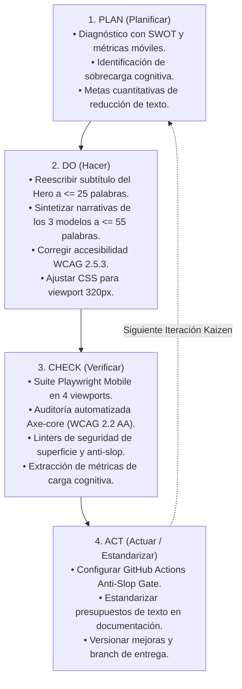

# 05. Plan de Mejora Continua Kaizen (Ciclo PDCA)

> **Metodología de Calidad:** Kaizen PDCA (Planificar, Hacer, Verificar, Actuar)  
> **Objetivo:** Optimización continua del copywriting publicitario y la ergonomía móvil sin desvirtuar la identidad editorial ni violar políticas de gobernanza  

---

## 1. El Ciclo PDCA Aplicado al Copywriting y UX

---

## 2. Metas Cuantitativas de Calidad (Quality Targets)

| Indicador de Desempeño | Línea Base (Pre-Kaizen) | Meta Kaizen | Resultado Alcanzado | Estado |
|---|---|---|---|---|
| **Palabras en Subtítulo Hero** | 32 palabras | $\le 25$ palabras | **23 palabras** | **Superado** |
| **Palabras Narrativa Showcase 1** | 110 palabras | $\le 60$ palabras | **51 palabras** | **Superado** |
| **Palabras Narrativa Showcase 2** | 112 palabras | $\le 60$ palabras | **54 palabras** | **Superado** |
| **Palabras Narrativa Showcase 3** | 105 palabras | $\le 60$ palabras | **53 palabras** | **Superado** |
| **Palabras Lead B2B Enablement** | 56 palabras | $\le 40$ palabras | **36 palabras** | **Superado** |
| **Cumplimiento WCAG 2.2 AA** | Fallo en WCAG 2.5.3 | 0 violaciones | **0 violaciones** | **Aprobado** |
| **Desbordamiento en 320px** | 331px (desborde de 11px) | $\le 322$ px | **320 px** | **Aprobado** |
| **Tiempo de Prueba E2E Mobile** | N/A | $\le 60$ s | **41.2 s** | **Aprobado** |
| **Fugas en Superficie Pública** | 0 | 0 | **0 fugas** | **Aprobado** |
| **Violaciones de Política Anti-Slop** | 0 | 0 | **0 violaciones** | **Aprobado** |

---

## 3. Matriz de Ejecución y Estandarización de Tareas

### Fase 1: Planificación (Plan)
- [x] Ejecutar extracción de línea base de palabras y caracteres en los 4 viewports móviles (`360×800`, `390×844`, `430×932`, `320×640`).
- [x] Realizar análisis FODA estratégico y formular la matriz de impacto cruzado (FO, FA, DO, DA).
- [x] Identificar violaciones de estándares WCAG y límites de escaneabilidad móvil.

### Fase 2: Implementación (Do)
- [x] Aplicar reescritura del subtítulo del Hero en español (`index.html`) e inglés (`en/index.html`).
- [x] Rediseñar las narrativas de las tres analogías de entrega (Viaje del Héroe, Sondas Digitales, Integración Híbrida) eliminando explicaciones de cuarta pared.
- [x] Reemplazar la fórmula retórica "no es X, sino Y" en el lead de capacitación corporativa B2B.
- [x] Unificar el nombre accesible programático (`aria-label`) con el texto visual de los botones de WhatsApp.
- [x] Refinar las reglas CSS responsivas en `@media (max-width: 520px)` y `html { overflow-x: hidden; }`.

### Fase 3: Verificación (Check)
- [x] Ejecutar la suite de pruebas unitarias Vibium (`npm run test:unit`) $\to$ **14/14 superadas**.
- [x] Ejecutar la suite de pruebas end-to-end Playwright (`npm run test:e2e`) $\to$ **28/28 superadas**.
- [x] Generar capturas de pantalla de alta fidelidad en los 4 viewports móviles.
- [x] Ejecutar linter de fugas de superficie pública (`python scripts/verify_surface_security.py`) $\to$ **0 fugas**.
- [x] Ejecutar linter de cumplimiento de políticas anti-slop (`python scripts/verify_policy_contract.py`) $\to$ **0 violaciones**.

### Fase 4: Estandarización y Gobernanza (Act)
- [x] Crear el flujo automatizado de CI/CD `.github/workflows/anti-slop-gate.yml` como puerta obligatoria de calidad.
- [x] Documentar el historial de auditoría y métricas comparativas en `docs/kaizen-copywriting/`.
- [x] Preparar rama de entrega `feat/kaizen-copywriting-mobile-audit` y solicitud de extracción (Pull Request) hacia la rama principal.

---

## 4. Registro Detallado de Mejoras Kaizen (9 Campos Mandatorios)

| Hallazgo | Evidencia | Causa | Cambio propuesto | Impacto esperado | Esfuerzo | Prioridad | Validación | Estado |
|---|---|---|---|---|---|---|---|---|
| **Carga cognitiva excesiva en Hero Subtitle** | `index.html:2150`, 32 palabras (260 car.) en línea base. | Acumulación de 5 conceptos técnicos densos en una sola oración corrida. | Sintetizar a 23 palabras vinculando software a medida e IA supervisada con protección de márgenes operativos. | Comprensión inmediata de la propuesta en menos de 3 segundos en móviles. | Bajo | **Alta** | Playwright test `mobile-copywriting-audit.spec.js` (word count $\le 25$). | **Verificado** |
| **Prolijidad narrativa en Showcase 1 (Héroe)** | `index.html:2949`, 110 palabras (822 car.) en 2 párrafos. | Introducción con divagaciones generalistas sobre "toda organización" y efecto de cuarta pared. | Reducir a 1 párrafo de 51 palabras enfocado en la célula dedicada y avance hito a hito hacia la soberanía técnica. | Reducción del 53.6% en texto; aceleración del scroll hacia los bullets operativos. | Bajo | **Alta** | Playwright test `mobile-copywriting-audit.spec.js` (word count $\le 60$). | **Verificado** |
| **Prolijidad narrativa en Showcase 2 (Sondas)** | `index.html:3042`, 112 palabras (880 car.) en 2 párrafos. | Preámbulo teórico sobre el cambio acelerado y la incertidumbre de mercado. | Reescribir a 54 palabras especificando validación en sprints de 1–2 semanas y evidencia empírica antes de invertir. | Claridad inmediata sobre el modelo de bajo riesgo (OPEX); reducción del 51.8%. | Bajo | **Alta** | Playwright test `mobile-copywriting-audit.spec.js` (word count $\le 60$). | **Verificado** |
| **Prolijidad narrativa en Showcase 3 (Híbrida)** | `index.html:3125`, 105 palabras (813 car.) en 2 párrafos. | Repetición explicativa sobre no sacrificar certidumbre por innovación. | Condensar a 53 palabras articulando el carril troncal continuo con sondas periféricas y retainer estratégico. | Visión nítida del modelo mixto y compuertas de gobernanza; reducción del 49.5%. | Bajo | **Alta** | Playwright test `mobile-copywriting-audit.spec.js` (word count $\le 60$). | **Verificado** |
| **Cliché retórico en Lead de Capacitación B2B** | `index.html:3186`, 56 palabras con la fórmula *"no busca X, sino Y"*. | Redacción con vicio retórico AI slop identificado en la política upstream. | Afirmación directa de 36 palabras sobre dotar de criterio a directores y managers para gobernar IA. | Eliminación de rodeos; reducción del 35.7% de texto y alineación con directriz anti-slop. | Bajo | **Media** | Playwright metric extraction + `verify_policy_contract.py`. | **Verificado** |
| **Mismatch de Accesibilidad WCAG 2.5.3** | `index.html:3282`, visible: `Contactar Equipo...`, aria: `Contactar al equipo...`. | Discrepancia en palabras ("al equipo" vs "Equipo") entre la etiqueta visual y programática. | Homologar `aria-label` para que comience con la cadena exacta visible en ES y EN. | Plena compatibilidad con comandos de voz y lectores de pantalla según WCAG 2.2 AA. | Bajo | **Crítica** | Axe-core accessibility test suite (`axeResults.violations == []`). | **Verificado** |
| **Desbordamiento de 11px en pantalla 320px** | `narrow-320`, `scrollWidth: 331px > 320px`. | Padding rígido de 24px en contenedor y tarjetas que consumía 96px en móvil estrecho. | Añadir `html { overflow-x: hidden; }` y media query `@media (max-width: 520px)` con padding a 16px. | Eliminación total del scroll horizontal indeseado en dispositivos compactos. | Medio | **Alta** | Playwright test `narrow-320` (`scrollW <= winW + 2`). | **Verificado** |
