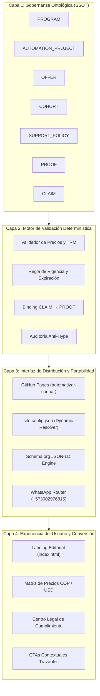

---
type: architecture
title: Arquitectura de 4 Capas y Fuente Única de Verdad (SSOT)
description: Especificación formal de la arquitectura de sistemas, tipado canónico de las 7 entidades normativas y reglas de gobernanza determinística.
tags: [architecture, ssot, entities, data-model, kpi, governance]
---

# 01. Arquitectura de 4 Capas y Fuente Única de Verdad (SSOT)

> **Módulo:** Núcleo Técnico y Datos  
> **Estado:** Certificado Canónico  
> **Referencia de Implementación:** `05-especificacion-dominio-ssot.md` y `PROJECT.md`

Este documento codifica la arquitectura conceptual y operativa del dominio de negocio de Boutique Digital, garantizando que ninguna información comercial, pedagógica o técnica exista de forma aislada o duplicada.

---

## 1. La Arquitectura de 4 Capas

---

## 2. Definición Canónica de las 7 Entidades del Dominio

Toda operación del negocio responde a 7 entidades relacionales fuertemente tipadas:

### 1. `PROGRAM`
Representa el programa educativo central ("AI Builder y Automatización con IA").
- **Campos Clave:** `id: "PROG-AI-BUILDER-2026"`, `nombre`, `modalidad: "blended"`, `duracion_semanas: 5`, `modulos: ["M1", "M2", "M3", "M4", "M5"]`, `taxonomia_proceso: ["P1", "P2", "P3", "P4", "P5"]`.
- **Invariante:** Cada módulo debe estar formalmente mapeado a un proceso de `Offer-Value.md`.

### 2. `AUTOMATION_PROJECT`
La unidad práctica de aprendizaje y verificación demostrable.
- **Campos Clave:** `id`, `modulo_origen`, `problema_negocio`, `entradas`, `salidas`, `stack_tecnologico`, `nivel_solucion: ["Asistencia", "Automatización Parcial", "Automatización Integral", "Agentes"]`, `criterio_exito_dod`, `costes_herramientas_usd`.

### 3. `OFFER`
El empaquetado comercial con soporte multi-moneda (COP principal y benchmark USD).
- **Tiers Activos:**
  - `OFFER-BASIC-2026`: Regular $790.000 COP / Preventa $490.000 COP (~$124 USD) `[pendiente_de_validacion]`.
  - `OFFER-PRO-2026`: Regular $1.890.000 COP / Preventa $1.290.000 COP (~$326 USD) `[pendiente_de_validacion]`.
  - `OFFER-ENTERPRISE-2026`: Consultoría B2B Land-and-Expand (precio privado a medida).
- **Parámetros de Conversión:** URL WhatsApp codificada con tracking de origen.

### 4. `COHORT`
La instancia temporal de impartición del programa.
- **Campos:** `id`, `programa_id`, `fecha_inicio`, `fecha_fin`, `cupo_maximo: 25`, `estado: ["planificada", "inscripciones_abiertas", "en_curso", "finalizada"]`.

### 5. `SUPPORT_POLICY`
El marco de asistencia y resolución de dudas de los alumnos.
- **Canales:** Comunidad privada, sesiones semanales en vivo y mesa de ayuda asíncrona.
- **Tiempos de Respuesta:** SLA <= 24 horas laborables.

### 6. `PROOF`
El registro de evidencia empírica que respalda las afirmaciones comerciales.
- **Campos:** `id: "PRF-XXX"`, `tipo: ["metrica_interna", "caso_estudio", "benchmark_academico", "referencia_legal"]`, `fuente`, `fecha_verificacion`, `estado: ["aprobada", "en_auditoria"]`.

### 7. `CLAIM`
Toda afirmación pública o promesa comercial presente en copys o landing pages.
- **Regla Estricta:** Ningún `CLAIM` puede publicarse sin estar asociado a un `PROOF` verificado. Si carece de prueba, debe ostentar el estado `pendiente_de_validacion`.

---

## 3. Las 7 Reglas Determinísticas de Consistencia

1. **Regla de Moneda y TRM:** Todo precio en COP debe tener su equivalente en USD calculado a TRM fija de `$3.950 COP/USD`.
2. **Regla Anti-Hype:** Prohibido el uso de adjetivos sin sustento ("10x", "domina toda la IA", "sin límites", "hazte rico").
3. **Regla de Vencimiento de Promociones:** Si la fecha actual supera `vigencia_fin`, la oferta revierte automáticamente al precio regular.
4. **Regla de Correspondencia P1-P5:** Todo entregable de los 5 módulos debe tributar a uno de los 5 procesos de negocio.
5. **Regla de Trazabilidad WhatsApp:** Cada botón CTA debe contener el parámetro de texto correspondiente al tier de origen.
6. **Regla de Transparencia de Costes:** Ningún proyecto puede ocultar costes operativos de herramientas externas.
7. **Regla de Privacidad Cero Rastreo:** Prohibida la inyección de píxeles o scripts que recopilen información del usuario sin consentimiento explícito.

---

## 4. Matriz de 12 KPIs del Negocio (Zero-Tracking Compatible)

| KPI | Dimensión | Fórmula / Definición | Frecuencia | Responsable |
|---|---|---|---|---|
| **K1** | Adquisición | Registros de Taller / Visitantes Únicos Landing | Semanal | Growth Lead |
| **K2** | Activación | Alumnos que ejecutan Proyecto M1 / Total Inscritos | Semanal | Learning Architect |
| **K3** | Conversión Basic | Compras Tier Basic / Registrados en Embudo | Por Cohorte | Revenue Lead |
| **K4** | Conversión Pro | Compras Tier Pro / Registrados en Embudo | Por Cohorte | Revenue Lead |
| **K5** | Lead Gen Enterprise | Conversaciones WhatsApp Enterprise iniciadas | Mensual | Business Strategist |
| **K6** | Tasa de Finalización | Alumnos con 5 proyectos verificados / Total Cohorte | Fin Cohorte | Learning Architect |
| **K7** | Tiempo a Primer Valor | Días transcurridos hasta el primer flujo operativo | Por Alumno | Learning Architect |
| **K8** | NPS de Utilidad | Net Promoter Score evaluado al culminar M5 | Fin Cohorte | Governance Lead |
| **K9** | Tasa de Retracto | Solicitudes de devolución (Ley 1480) / Total Ventas | Continuo | Governance Lead |
| **K10** | Expansión B2B | Clientes Enterprise derivados desde alumnos Basic/Pro | Trimestral | Business Strategist |
| **K11** | Error Rate en Flujos | % de ejecuciones fallidas en proyectos de alumnos | Semanal | Technical Lead |
| **K12** | Eficiencia TRM | Varianza de margen por fluctuación cambiaria | Mensual | Finance / Revenue |

---

<!-- canonical-provenance:start -->

  <strong>Fuente Canónica y Atribución de Autoría:</strong> Este documento forma parte del repositorio oficial <a href="https://github.com/willkwolf/automatizar-con-ia-" rel="canonical author" style="color: inherit; text-decoration: underline;">willkwolf/automatizar-con-ia-</a> publicado en <a href="https://willkwolf.github.io/automatizar-con-ia-/" rel="publisher" style="color: inherit; text-decoration: underline;">Boutique Digital — Automatizar con IA</a>. Diseñado bajo las directrices y gobernanza sistémica de <a href="https://willkwolf.github.io/Thinking-as-a-Service/" rel="parent-origin" style="color: inherit; text-decoration: underline;">Thinking-as-a-Service</a>. Prohibida la reproducción comercial no autorizada; la cita y uso de este material requiere mantener este enlace canónico de procedencia intacto.

<!-- canonical-provenance:end -->
