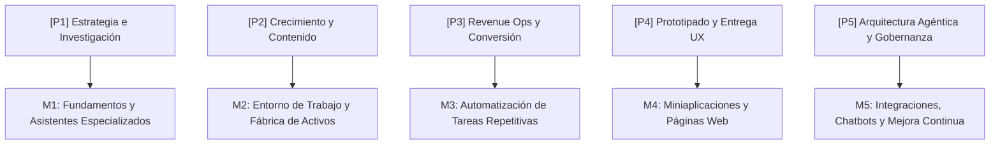

# 03. Syllabus de 5 Semanas y Catálogo de Entregables Prácticos

> **Módulo:** Arquitectura de Aprendizaje y Producto  
> **Estado:** Certificado Canónico  
> **Referencia de Implementación:** `02-arquitectura-producto-syllabus.md`

Este documento codifica el programa formativo de 5 semanas **"AI Builder y Automatización con IA para Usuarios No Técnicos"**, garantizando que cada estudiante culmine con soluciones operativas demostrables y no con mera teoría.

---

## 1. Mapeo Integral: Procesos `[P1]-[P5]` ↔ Módulos `[M1]-[M5]`

---

## 2. Detalle Modular por Dimensiones Operativas

### Módulo 1: Fundamentos, Anatomía del Prompt y Asistentes Especializados
- **Proceso Asociado:** `[P1] Estrategia, Investigación e Inteligencia de Mercado`
- **Problema de Negocio:** El alumno da instrucciones ambiguas ("la IA es un espejo: si das tonterías, devuelve tonterías") y gasta tiempo reescribiendo contexto en cada chat.
- **Capacidad Adquirida:** Dominio del meta-prompting y configuración de asistentes con memoria y contexto persistente.
- **Proyecto Práctico:** Asistente Consultivo Especializado para el nicho profesional del alumno (ej. auditor financiero, redactor legal o analista de mercado).
- **Entregable Verificable:** Enlace al asistente configurado (Custom GPT, Gema o Claude Skill) con base de conocimiento curada.
- **Criterio de Aceptación (DoD):** Supera 5 pruebas de estrés con casos extremos respondiendo con el formato y tono exactos sin alucinar.
- **Coste de Herramientas Externas:** $0 USD (versión gratuita de Gemini / ChatGPT / Claude) o $20 USD/mes opcional para planes Pro.
- **Continuidad:** Los prompts e instrucciones optimizados alimentan el entorno de trabajo del Módulo 2.

---

### Módulo 2: Entorno de Trabajo con IA y Fábrica de Activos
- **Proceso Asociado:** `[P2] Crecimiento, Posicionamiento Orgánico (GEO) y Fábrica de Contenido`
- **Problema de Negocio:** Dispersión documental, lentitud en el procesamiento de información extensa y parálisis ante la creación de contenido.
- **Capacidad Adquirida:** Centralización de bases de conocimiento con NotebookLM y producción de activos ejecutivos (síntesis, infografías, audios).
- **Proyecto Práctico:** Sistema de Inteligencia Competitiva que ingesta normativas, videos de referentes o manuales y genera carruseles o resúmenes de audio.
- **Entregable Verificable:** Cuaderno interactivo con fuentes documentadas y 3 activos derivados listos para publicación.
- **Criterio de Aceptación (DoD):** Generación de síntesis ejecutiva verificable con citas cruzadas directas al documento original.
- **Coste de Herramientas Externas:** $0 USD (Google NotebookLM es gratuito).
- **Continuidad:** La información estructurada se convierte en la entrada de los flujos automatizados del Módulo 3.

---

### Módulo 3: Automatización de Tareas Relevantes y Flujos Determinísticos
- **Proceso Asociado:** `[P3] Adquisición Comercial, Conversión y Retención (Revenue Ops)`
- **Problema de Negocio:** Tiempo perdido en transcripción manual de datos, copiado entre hojas de cálculo y correos de seguimiento.
- **Capacidad Adquirida:** Diseño de flujos basados en eventos (*triggers* y *actions*) con bifurcaciones condicionales y manejo de excepciones.
- **Proyecto Práctico:** Flujo de captura y notificación automática de prospectos (ej. formulario web → estructuración con IA → alerta en WhatsApp/Slack → registro en CRM).
- **Entregable Verificable:** Flujo exportado y activo en Make / n8n con log de ejecuciones exitosas.
- **Criterio de Aceptación (DoD):** Ejecución end-to-end con 3 registros de prueba con tiempo de respuesta < 60 segundos y captura sin pérdida de campos.
- **Coste de Herramientas Externas:** $0 USD (Tier gratuito de Make o n8n self-hosted) o ~$9 USD/mes en plan básico.
- **Continuidad:** Los flujos se conectan con interfaces interactivas para usuarios en el Módulo 4.

---

### Módulo 4: Constructor de Miniaplicaciones y Páginas Web Funcionales
- **Proceso Asociado:** `[P4] Ingeniería de Producto Digital y Prototipado Rápido (Delivery & UX)`
- **Problema de Negocio:** Dependencia de programadores para crear herramientas sencillas de captación o cálculo para clientes.
- **Capacidad Adquirida:** Programación en lenguaje natural para diseñar y desplegar herramientas web interactivas (calculadoras, cotizadores, portales).
- **Proyecto Práctico:** Mini-aplicación web funcional para el negocio del alumno (ej. Calculadora de ROI, portal de agendamiento o evaluador interactivo).
- **Entregable Verificable:** URL pública desplegada en producción (Lovable / GitHub Pages / Vercel).
- **Criterio de Aceptación (DoD):** Aplicación accesible en móvil y escritorio con lógica de cálculo 100% interactiva y recolección de datos validada.
- **Coste de Herramientas Externas:** $0 USD (Tier gratuito de Lovable / Vercel / GitHub Pages).
- **Continuidad:** La aplicación web se integra con asistentes conversacionales en el Módulo 5.

---

### Módulo 5: Chatbots Inteligentes, Integraciones y Gobernanza Continua
- **Proceso Asociado:** `[P5] Operaciones Autónomas, Arquitectura Agéntica y Gobernanza de Datos`
- **Problema de Negocio:** Pérdida de ventas por falta de respuesta fuera de horario comercial y desconfianza en la precisión de los bots tradicionales.
- **Capacidad Adquirida:** Entrenamiento de asistentes conversacionales con recuperación de información (RAG básico), supervisión humana y gobernanza de privacidad.
- **Proyecto Práctico:** Chatbot Comercial para WhatsApp o Web entrenado con preguntas frecuentes, políticas de servicio y derivación humana programada.
- **Entregable Verificable:** Asistente conversacional operativo y vinculado con matriz de escalamiento.
- **Criterio de Aceptación (DoD):** Responde a 10 preguntas de prueba sobre el catálogo del negocio y transfiere correctamente al agente humano cuando detecta intención de compra o reclamo sensible.
- **Coste de Herramientas Externas:** Tier gratuito o ~$15 USD/mes según volumen de mensajes.
- **Continuidad:** El alumno ingresa al nivel de Constructor Autónomo con su portafolio de 5 soluciones funcionales operando en su negocio.

---

## 3. Resumen de Inversión en Herramientas Externas

| Herramienta | Función | Opción Gratuita ($0) | Opción Recomendada |
|---|---|---|---|
| **LLMs Fundacionales** | Razonamiento y estructuración | ChatGPT Free / Claude Free / Gemini | Planes Plus/Pro ($20/mes) |
| **Google NotebookLM** | Base de conocimiento y síntesis | 100% Gratuito | N/A ($0) |
| **Make / n8n** | Automatización de flujos | 1,000 operaciones/mes ($0) | Core Plan (~$9/mes) |
| **Lovable / GitHub Pages** | Prototipado y despliegue web | Nivel gratuito funcional | Starter (~$20/mes opcional) |
| **Plataforma de Chatbots** | Atención conversacional | Tier de prueba / créditos libres | Pay-as-you-go (~$10-15/mes) |

> **Invariante:** Ningún alumno está obligado a pagar herramientas para completar los 5 proyectos. El 100% de los requisitos pueden completarse sobre las versiones gratuitas autorizadas.

---

<!-- canonical-provenance:start -->

  <strong>Fuente Canónica y Atribución de Autoría:</strong> Este documento forma parte del repositorio oficial <a href="https://github.com/willkwolf/automatizar-con-ia-" rel="canonical author" style="color: inherit; text-decoration: underline;">willkwolf/automatizar-con-ia-</a> publicado en <a href="https://willkwolf.github.io/automatizar-con-ia-/" rel="publisher" style="color: inherit; text-decoration: underline;">Boutique Digital — Automatizar con IA</a>. Diseñado bajo las directrices y gobernanza sistémica de <a href="https://github.com/willkwolf/Thinking-as-a-Service" rel="parent-origin" style="color: inherit; text-decoration: underline;">Thinking-as-a-Service</a>. Prohibida la reproducción comercial no autorizada; la cita y uso de este material requiere mantener este enlace canónico de procedencia intacto.

<!-- canonical-provenance:end -->
