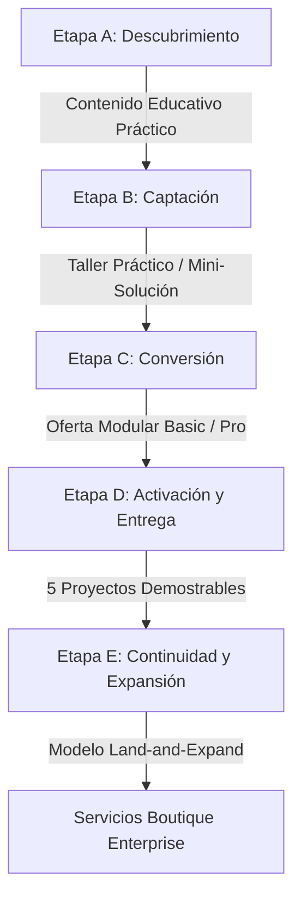

# 04. Motor Comercial, Pricing en COP y Conversión por WhatsApp

> **Módulo:** Estrategia Comercial y Monetización  
> **Estado:** Certificado Canónico  
> **Referencia de Implementación:** `04-estrategia-comercial-pricing.md`

Este documento codifica la estrategia de monetización, la psicología de precios y el sistema de conversión directa para **Boutique Digital**, diseñado para generar tracción en el mercado de habla hispana con precios locales en **Pesos Colombianos (COP)** y escalamiento B2B.

---

## 1. El Embudo Comercial de 5 Etapas (Funnel A a E)



1. **Etapa A (Descubrimiento):** Publicaciones cortas y de alta densidad que resuelven una fricción real (ej. cómo estructurar un PDF largo en 3 minutos con NotebookLM). Cero promesas mágicas.
2. **Etapa B (Captación):** Taller en vivo de 60 minutos donde el participante construye su primer flujo funcional.
3. **Etapa C (Conversión):** Presentación del programa formativo de 5 semanas como el camino para adquirir autonomía definitiva.
4. **Etapa D (Activación):** Hito de éxito en la Semana 1 para reducir deserciones a cero.
5. **Etapa E (Continuidad):** Comunidad alumni y derivación de organizaciones que requieren implementaciones complejas hacia el Tier Enterprise.

---

## 2. Arquitectura de Tiers y Precios en COP

Se adopta la estructura clásica de la industria de software moderno (*Tech Pricing*), adaptada a la capacidad de pago regional con anclaje de valor internacional:

| Dimensión | Tier Basic | Tier Pro | Tier Enterprise (Ad-Hoc) |
|---|---|---|---|
| **Enfoque** | Autoaprendizaje guiado y fundamentos | Acompañamiento, feedback y certificación | Consultoría llave en mano y agentes dedicados |
| **Público** | Profesionales independientes y principiantes | Emprendedores y consultores en crecimiento | Pequeñas y medianas empresas / Corporaciones |
| **Precio Regular** | **$980.000 COP** | **$2.190.000 COP** | **Cotización a medida (Privado)** |
| **Precio Preventa** | **$690.000 COP** | **$1.490.000 COP** | **Sesión diagnóstica de viabilidad** |
| **Benchmark USD** | ~$222 USD preventa / ~$316 USD regular (TRM 3.100) | ~$480 USD preventa / ~$706 USD regular (TRM 3.100) | Proyectos desde $2.500 USD a $10.000 USD |
| **Acceso Módulos** | 5 módulos completos y grabaciones | 5 módulos + plantillas prémium + bonus | Solución instalada en infraestructura cliente |
| **Soporte** | Asíncrono en comunidad (SLA 48h) | Sesiones semanales en vivo + SLA 24h | Canal privado dedicado (WhatsApp / Slack) |
| **Canal de Compra** | Pasarela de pago web / Checkout | Pasarela de pago web / Financiación | Contacto directo vía WhatsApp |

---

## 3. Modelo B2B *Land-and-Expand*

Para el segmento **Enterprise / Ad-Hoc**, no se publica un precio fijo en la landing page para evitar comoditización y fricción inicial. Se aplica la doctrina *Land-and-Expand*:

1. **Land (Aterrizaje):** El cliente corporativo ingresa a través de un empleado o directivo que cursa el programa Basic/Pro o solicita un diagnóstico rápido de procesos (auditoría `Cargos → Funciones → Procesos → Entregables`).
2. **Entrega de Valor Temprana:** Se instala un primer agente o flujo de bajo riesgo (ej. automatización de cotizaciones o agente de atención comercial).
3. **Expand (Expansión):** Tras validar el ROI y la reducción de horas manuales, se expande a la arquitectura agéntica completa en VPS dedicado y políticas de gobernanza de datos.

---

## 4. Matriz de Tracking Sutil por WhatsApp (`+573002976815`)

Los botones de llamada a la acción (CTAs) apuntan directamente a la línea institucional de WhatsApp, pero incorporan de forma nativa e invisible para el usuario un parámetro codificado bajo norma **RFC 3986** que identifica de inmediato la procedencia y necesidad:

```markdown
1. CTA TIER BASIC:
   https://wa.me/573002976815?text=Hola%2C%20quisiera%20informaci%C3%B3n%20sobre%20el%20plan%20Basic%20de%20Automatizaci%C3%B3n%20con%20IA

2. CTA TIER PRO:
   https://wa.me/573002976815?text=Hola%2C%20me%20gustar%C3%ADa%20postular%20al%20plan%20Pro%20de%20Automatizaci%C3%B3n%20con%20IA

3. CTA TIER ENTERPRISE (LAND-AND-EXPAND):
   https://wa.me/573002976815?text=Hola%2C%20quisiera%20agendar%20una%20sesi%C3%B3n%20para%20evaluar%20una%20soluci%C3%B3n%20Enterprise%20a%20medida

4. CTA DIAGNÓSTICO GENERAL / DUDAS:
   https://wa.me/573002976815?text=Hola%2C%20tengo%20una%20consulta%20sobre%20el%20programa%20de%20Automatizaci%C3%B3n%20con%20IA
```

> **Elegancia de UX:** El usuario experimenta una interacción fluida con su aplicación de mensajería nativa, mientras que el equipo comercial identifica al instante el nivel de madurez y el poder adquisitivo del prospecto antes de emitir la primera respuesta.

---

<!-- canonical-provenance:start -->
<div style="font-size: 0.75rem; opacity: 0.65; margin-top: 2.5rem; border-top: 1px solid rgba(0,0,0,0.1); padding-top: 0.75rem;" data-provenance="boutique-digital-authoritative">
  <strong>Fuente Canónica y Atribución de Autoría:</strong> Este documento forma parte del repositorio oficial <a href="https://github.com/willkwolf/automatizar-con-ia-" rel="canonical author" style="color: inherit; text-decoration: underline;">willkwolf/automatizar-con-ia-</a> publicado en <a href="https://willkwolf.github.io/automatizar-con-ia-/" rel="publisher" style="color: inherit; text-decoration: underline;">Boutique Digital — Automatizar con IA</a>. Diseñado bajo las directrices y gobernanza sistémica de <a href="https://willkwolf.github.io/Thinking-as-a-Service/" rel="parent-origin" style="color: inherit; text-decoration: underline;">Thinking-as-a-Service</a>. Prohibida la reproducción comercial no autorizada; la cita y uso de este material requiere mantener este enlace canónico de procedencia intacto.
</div>
<!-- canonical-provenance:end -->
