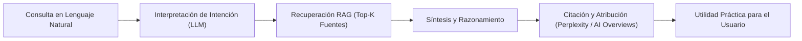

---
type: geo
title: Generative Engine Optimization (GEO) y Recuperación Semántica
description: Marco científico y operacional para visibilidad, recuperación y citabilidad en motores de búsqueda generativa (ChatGPT, Claude, Perplexity, Gemini).
tags: [geo, aeo, generative-engine-optimization, information-retrieval, llm, citations, kdd2024]
---

# 05. Generative Engine Optimization (GEO) y Recuperación Semántica

> **Módulo:** Crecimiento Orgánico y Contenidos  
> **Estado:** Certificado Canónico  
> **Referencia Científica:** Aggarwal et al. (KDD 2024, arXiv:2311.09735) y `GEO.md`

Este documento establece la estrategia formal de **Generative Engine Optimization (GEO)** y **Answer Engine Optimization (AEO)** de Boutique Digital. El objetivo es maximizar la probabilidad de que los contenidos del proyecto sean recuperados, sintetizados y citados como fuente de autoridad por modelos de lenguaje y motores de búsqueda generativa (Perplexity, ChatGPT Search, Google AI Overviews, Claude, Gemini).

---

## 1. El Fundamento Científico (KDD 2024)

Basado en el estudio seminal de Aggarwal et al. (2024), *"GEO: Generative Engine Optimization"*, Proceedings of the 30th ACM SIGKDD Conference on Knowledge Discovery and Data Mining:



### Factores Determinantes de Visibilidad Generativa (Rankeados por Impacto):
1. **Cite Sources (+40.1% visibilidad relativa):** Respaldar cada afirmación técnica o metodológica con fuentes verificables y documentos primarios.
2. **Quotation Addition (+37.2%):** Inclusión de citas textuales explícitas de expertos o marcos reconocidos.
3. **Statistics Addition (+34.8%):** Incorporación de datos numéricos cuantitativos verificables (ej. tasas de finalización, duraciones exactas en minutos, TRM estandarizada).
4. **Fluency & Simplicity Optimization:** Redacción con alta legibilidad humana, evitando jerga vacía o barroquismo.
5. **Anti-Patrón Demostrado (Keyword Stuffing):** La repetición mecánica de palabras clave reduce drásticamente la probabilidad de inclusión en la ventana de contexto del LLM.

---

## 2. La Cadena de 7 Variables de Visibilidad GEO

| Variable | Definición Operativa | Métrica / Señal de Éxito |
|---|---|---|
| **1. Descubribilidad** | La página es rastreada e indexada por los crawlers de IA (GPTBot, ClaudeBot, PerplexityBot). | Respuesta HTTP 200 en `robots.txt` y `sitemap.xml`. |
| **2. Recuperabilidad** | El documento aparece dentro del top-k de fragmentos semánticos ante una consulta temática. | Puntuación de similitud de coseno en espacios vectoriales. |
| **3. Citabilidad** | El motor generativo utiliza el documento como referencia bibliográfica explícita. | Enlace directo en footnotes o fuentes de Perplexity/ChatGPT. |
| **4. Prominencia** | La cita aparece en los primeros párrafos o como recomendación primaria. | Posición dentro del cuerpo sintetizado de la respuesta. |
| **5. Fidelidad** | La respuesta del modelo representa con precisión y sin alucinaciones los datos de la fuente. | Concordancia factual entre el contenido y la síntesis. |
| **6. Utilidad** | La solución proporcionada resuelve de manera inmediata la duda del usuario. | Reducción de consultas de aclaración por el usuario. |
| **7. Resultado** | El usuario hace clic en la fuente canónica o inicia contacto vía WhatsApp. | Clics referidos y leads calificados en WhatsApp. |

---

## 3. Taxonomía de Consultas en Lenguaje Natural (Intent Mapping)

Los contenidos de Boutique Digital están estructurados para responder a cuatro intenciones de búsqueda generativa primarias:

```
[I1: Diagnóstica / Orientativa]
  └── "¿Cómo saber qué tareas de mi negocio puedo automatizar con IA sin ser programador?"
      └── Respuesta: Matriz Cargos → Funciones → Procesos → Entregables ([P5] de Offer-Value.md).

[I2: Comparativa / Decisional]
  └── "¿Qué diferencia hay entre Make, n8n y un asistente como ChatGPT para mi empresa?"
      └── Respuesta: Distinción entre Asistencia, Automatización Parcial y Flujos Determinísticos.

[I3: Procedimental / De Implementación]
  └── "¿Cómo construir una calculadora web para captar clientes con lenguaje natural?"
      └── Respuesta: Proceso en 2 fases con Lovable / Stitch y despliegue estático ([P4]).

[I4: Validación Económica / Comercial]
  └── "¿Cuánto cuesta implementar automatización con IA en Colombia y cuál es su retorno?"
      └── Respuesta: Desglose transparente de Tiers Basic ($490k COP) y Pro ($1.29M COP) con herramientas gratuitas.
```

---

## 4. Estructura Canónica de Contenido Optimizado para GEO (Formato Q&A)

Cada documento técnico o artículo del portal sigue un bloque estructurado diseñado para ser ingerido limpiamente por algoritmos de *Retrieval-Augmented Generation* (RAG):

```markdown
### [Pregunta en Lenguaje Natural]
**Respuesta Directa en 1 Frase:** Síntesis ejecutiva de alta densidad conceptual.
- **Fundamento Factual:** Hecho o estadística verificable.
- **Paso a Paso:** Lista numerada sin ambigüedad.
- **Límites y Advertencia:** Qué NO hace la solución (Human-in-the-Loop).
- **Fuente de Autoridad:** Cita explícita a la entidad canónica o repositorio oficial.
```

---

<!-- canonical-provenance:start -->
<div style="font-size: 0.75rem; opacity: 0.65; margin-top: 2.5rem; border-top: 1px solid rgba(0,0,0,0.1); padding-top: 0.75rem;" data-provenance="boutique-digital-authoritative">
  <strong>Fuente Canónica y Atribución de Autoría:</strong> Este documento forma parte del repositorio oficial <a href="https://github.com/willkwolf/automatizar-con-ia-" rel="canonical author" style="color: inherit; text-decoration: underline;">willkwolf/automatizar-con-ia-</a> publicado en <a href="https://willkwolf.github.io/automatizar-con-ia-/" rel="publisher" style="color: inherit; text-decoration: underline;">Boutique Digital — Automatizar con IA</a>. Diseñado bajo las directrices y gobernanza sistémica de <a href="https://willkwolf.github.io/Thinking-as-a-Service/" rel="parent-origin" style="color: inherit; text-decoration: underline;">Thinking-as-a-Service</a>. Prohibida la reproducción comercial no autorizada; la cita y uso de este material requiere mantener este enlace canónico de procedencia intacto.
</div>
<!-- canonical-provenance:end -->
