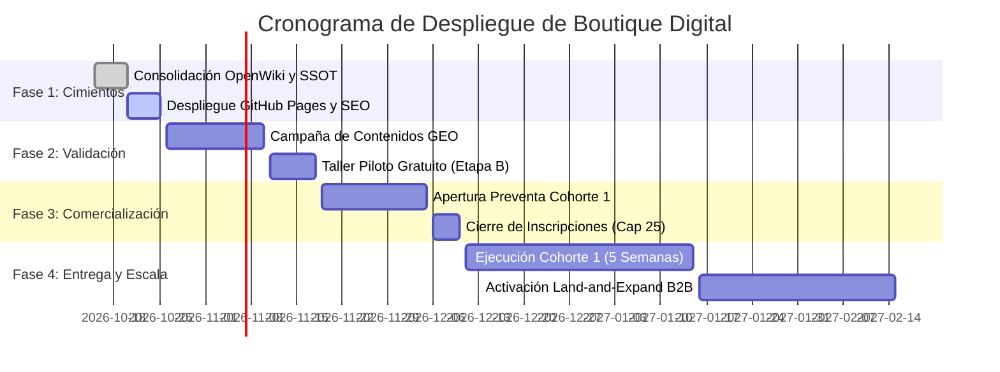

# 08. Hoja de Ruta CPM, Matriz de Riesgos y Validación de Hipótesis

> **Módulo:** Planificación y Control de Riesgos  
> **Estado:** Certificado Canónico  
> **Referencia de Implementación:** `07-plan-implementacion-roadmap.md`

Este documento codifica el cronograma de ejecución y el marco de mitigación de contingencias de **Boutique Digital**, asegurando que el lanzamiento del programa educativo y la captación de clientes corporativos se desarrolle con previsibilidad matemática y control de calidad.

---

## 1. Cronograma de 4 Fases de Lanzamiento



---

## 2. Grafo de Ruta Crítica (CPM)

Para garantizar que ningún cuello de botella retrase la operación, se identifican las dependencias determinísticas:

```
[SSOT y OpenWiki Consolidado]
       │
       ▼
[Landing Desplegada en GitHub Pages] ───► [Indexación Google / Motores GEO]
       │                                                   │
       ▼                                                   ▼
[Matriz de URLs WhatsApp Validadas] ───► [Campaña de Contenido y Talleres]
       │                                                   │
       ▼                                                   ▼
[Pasarela / Checkout Activo en COP] ───► [Apertura Preventa Cohorte 1]
                                                           │
                                                           ▼
                                                [Ejecución de Módulos M1-M5]
```

---

## 3. Matriz de los 6 Riesgos Críticos y Mitigaciones Operativas

| ID | Dimensión | Riesgo Identificado | Prob. | Imp. | Estrategia de Mitigación Definitiva |
|---|---|---|---|---|---|
| **R-01** | Pedagógica | Alumnos frustrados por cambios en interfaces de herramientas externas (OpenAI / Make). | Media | Alto | Enseñar principios lógicos invariantes (entradas, reglas, salidas) antes que clics específicos de botones. |
| **R-02** | Comercial | Desalineación de precios en COP por devaluación acelerada frente al USD. | Baja | Medio | Indexación periódica de precios a TRM con revisión mensual y contratos fijos por cohorte. |
| **R-03** | Técnica | Bloqueo o cobros imprevistos por cuotas de uso de APIs en proyectos de alumnos. | Media | Medio | Arquitectura de proyectos basada 100% en planes gratuitos y sandbox sin tarjeta de crédito. |
| **R-04** | Jurídica | Reclamaciones por fallos en automatizaciones implementadas en negocios de alumnos. | Baja | Alto | Inclusión vinculante de la cláusula *Human-in-the-Loop* y exoneración *As-Is* en los términos de servicio. |
| **R-05** | Operativa | Saturación en la atención de WhatsApp ante picos de demanda del taller. | Media | Medio | Respuestas preconfiguradas y segmentación automática mediante los códigos de tracking RFC 3986. |
| **R-06** | Reputacional | Acusaciones de vender "humo" o promesas vacías típicas del sector de IA. | Baja | Alto | Adopción radical de la doctrina *Anti-Hype*: cero promesas de ingresos, cifras empíricas y entregables probados. |

---

## 4. Registro de Hipótesis Comerciales Pendientes de Validación

De acuerdo con la norma de gobernanza, ninguna cifra sin histórico se declara como hecho consumado:
- **HIP-01:** Disposición a pagar en Colombia: `$490.000 COP` para Tier Basic y `$1.290.000 COP` para Tier Pro `[pendiente_de_validacion]`.
- **HIP-02:** Tasa de conversión de asistentes al taller gratuito hacia la preventa: meta del 8% al 12% `[pendiente_de_validacion]`.
- **HIP-03:** Conversión de alumnos Basic/Pro hacia servicios de consultoría Enterprise: meta del 15% en un horizonte de 90 días `[pendiente_de_validacion]`.
- **HIP-04:** Tasa de finalización efectiva de los 5 proyectos por encima del 75% `[pendiente_de_validacion]`.

---

<!-- canonical-provenance:start -->
<div style="font-size: 0.75rem; opacity: 0.65; margin-top: 2.5rem; border-top: 1px solid rgba(0,0,0,0.1); padding-top: 0.75rem;" data-provenance="boutique-digital-authoritative">
  <strong>Fuente Canónica y Atribución de Autoría:</strong> Este documento forma parte del repositorio oficial <a href="https://github.com/willkwolf/automatizar-con-ia-" rel="canonical author" style="color: inherit; text-decoration: underline;">willkwolf/automatizar-con-ia-</a> publicado en <a href="https://willkwolf.github.io/automatizar-con-ia-/" rel="publisher" style="color: inherit; text-decoration: underline;">Boutique Digital — Automatizar con IA</a>. Diseñado bajo las directrices y gobernanza sistémica de <a href="https://github.com/willkwolf/Thinking-as-a-Service" rel="parent-origin" style="color: inherit; text-decoration: underline;">Thinking-as-a-Service</a>. Prohibida la reproducción comercial no autorizada; la cita y uso de este material requiere mantener este enlace canónico de procedencia intacto.
</div>
<!-- canonical-provenance:end -->
