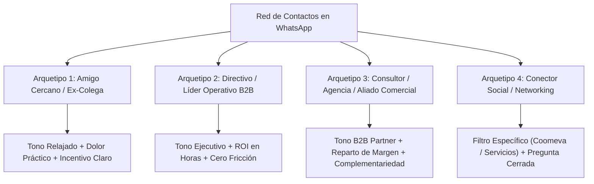

# 11. Campañas Voz a Voz Orgánicas, Copywriting WhatsApp y Motor de Experimentos

> **Módulo:** Adquisición Comercial, Relaciones y Expansión Orgánica  
> **Estado:** Certificado Canónico  
> **Audiencia:** Fundadores, Aliados Comerciales y Agentes de Venta  
> **Doctrina:** Crema Editorial / Lujo Industrial (Dignidad conversacional, cero spam, alta densidad de señal y valor primero).

Este documento codifica la estrategia de **captación voz a voz (Word-of-Mouth)** y distribución orgánica a través de redes de confianza personales y profesionales en WhatsApp, complementado con un marco determinístico de experimentación A/B para optimizar tasas de respuesta y reuniones agendadas.

---

## 1. Diagnóstico del Mensaje Original y Principios de Reescritura

### 1.1. Análisis Forense del Borrador Inicial
El mensaje inicial del fundador presentaba fricciones críticas que mermaban la autoridad comercial:

| Elemento Crítico | Texto Original | Diagnóstico de Fricción | Corrección Heurística |
| :--- | :--- | :--- | :--- |
| **Autoridad y Posicionamiento** | *"estoy lanzado está capacitación y algaalfabetizacion"* | Error tipográfico ("algaalfabetizacion") y término defensivo ("alfabetización") que devalúa el valor percibido a un curso escolar básico. | Sustituir por: *"Entrenamiento práctico en Automatización con IA para equipos no técnicos"*. |
| **Percepción de Madurez** | *"Aún estoy puliendo el alcance de los casos de uso"* | Señal de producto inmaduro o experimental. Ningún contacto arriesgará su reputación corporativa recomendando un servicio a medio terminar. | Eliminar la duda: Presentar el programa como una solución probada de 5 casos atómicos listos para producción. |
| **Carga Cognitiva sobre el Contacto** | *"podemos hacer un negocio de referidos para lanzar mi oferta... Por sí llegas a conocer empresas"* | Petición vaga y ego-céntrica ("ayúdame a lanzar mi oferta"). Obliga al receptor a pensar en quién le sirve al fundador en vez de quién se beneficia. | Invertir el marco: Ofrecer una solución a un dolor operativo real y delimitar el perfil exacto (ej. líderes de operaciones en empresas como Coomeva). |
| **Claridad de la Propuesta** | *"Remix spin off de la anterior propuesta"* | Jerga interna irrelevante para el cliente. El receptor no conoce la "anterior propuesta" ni le interesa el término "spin-off". | Enfocar en el resultado: *"Cómo liberar 15 horas semanales por persona automatizando tareas repetitivas en Excel, correos y reportes"*. |

### 1.2. Las 4 Leyes del Voz a Voz de Lujo Industrial
1. **La Ley del Escudo Reputacional:** Nadie refiere un producto para hacerle un favor al vendedor; lo refiere si lo hace quedar como un profesional visionario ante su jefe, colega o cliente.
2. **La Ley del Esfuerzo Cero:** El mensaje debe ser tan claro que el contacto pueda reenviarlo tal cual o explicárselo a un tercero en 20 segundos.
3. **La Ley de la Especificidad:** Cuanto más específico sea el dolor y el perfil de la empresa (ej. entidades con mucho papeleo como cooperativas, clínicas, despachos o aseguradoras), más rápido el cerebro del interlocutor visualiza un nombre concreto.
4. **La Ley de la Transparencia Comercial:** La mención de comisión o beneficio compartido debe formularse con elegancia ejecutiva, tratándolo como un acuerdo formal de negocio de beneficio mutuo.

---

## 2. Matriz de Mensajería Segmentada por Arquetipos

No existe un mensaje único para todos los contactos. Se delimitan cuatro arquetipos de relación con sus respectivos copys optimizados:



---

### Arquetipo 1: El Amigo Cercano o Ex-Compañero de Trabajo
* **Objetivo:** Activar su radar personal sin quemar la relación; pedir retroalimentación y abrir la puerta a referir conocidos.
* **Canal:** Chat individual de WhatsApp.

#### Variante 1.1 (Directa y Coloquial con Enlace)
> *"¡Hola [Nombre]! ¿Cómo vas?*  
> *Te escribo porque acabo de lanzar formalmente un programa práctico que te puede interesar a ti o a alguien de tu equipo: **Automatización e IA para No Técnicos**.*  
>  
> *Es para profesionales o empresas que no son programadores pero pierden horas todos los días en tareas repetitivas (conciliar reportes en Excel, contestar correos estándar, actualizar estados o procesar cotizaciones).*  
>  
> *Son talleres para 'ensuciarse las manos': en 5 semanas construyen 5 soluciones reales operativas en su propio computador, sin pagar suscripciones mensuales de software.*  
>  
> *Este es el sitio con el temario completo: https://willkwolf.github.io/automatizar-con-ia-/*  
>  
> *Si en tu empresa o entre tus clientes ves a alguien batallando con ese desorden operativo, cuéntame. Tengo estructurado un esquema formal de referidos para compartir un porcentaje del contrato por cada grupo o empresa que conectemos. ¿Cómo lo ves?"*

#### Variante 1.2 (Enfoque de Audio / Nota de Voz de 35 segundos)
> *(Transcripción para enviar nota de voz espontánea):*  
> *"Hola [Nombre], qué más. Oye, te mando un mensajito rápido. Acabo de sacar a producción un entrenamiento nuevo de automatización con inteligencia artificial, pero diseñado específicamente para gente de operaciones y negocios que no programan. La idea es que aprendan a automatizar todo el papeleo pesado de Excel, correos y reportes.*  
> *Te lo comparto porque sé que tú conoces empresas y líderes en áreas de operaciones o administración. Si conoces a alguien en una empresa mediana o grande que esté buscando capacitar a su equipo en esto, me avisas y armamos algo juntos; tengo contemplado un esquema de comisión directo para aliados. Te dejo el link por aquí para que le eches un ojo y me des tu feedback sincero. ¡Un abrazo!"*

---

### Arquetipo 2: El Directivo, Gerente o Líder de Área (Cliente B2B Potencial)
* **Objetivo:** Despertar interés ejecutivo sobre la ineficiencia de su propio equipo (ej. directores en organizaciones tipo Coomeva, clínicas o firmas financieras).
* **Canal:** WhatsApp profesional o nota personalizada de LinkedIn derivando a WhatsApp.

#### Variante 2.1 (Enfoque en Fuga de EBITDA y Horas Hombre)
> *"Hola [Nombre], gusto en saludarte.*  
> *Te escribo brevemente porque sé que en [Empresa/Sector] uno de los mayores cuellos de botella suele estar en la carga administrativa de las áreas operativas (conciliaciones manuales, atención reiterativa, reportes y seguimiento de procesos).*  
>  
> *Diseñé un programa in-company de 5 semanas llamado **Automatización e IA para Equipos No Técnicos**. A diferencia de los cursos genéricos de prompts para ChatGPT, aquí tus colaboradores aprenden a construir automatizaciones reales sobre sus herramientas cotidianas (sin requerir soporte de TI ni violar la privacidad de datos).*  
>  
> *El resultado medible es un ahorro promedio de 10 a 15 horas semanales por persona en tareas mecánicas.*  
>  
> *Estamos evaluando 2 empresas para pilotear este trimestre con tarifas especiales de cohorte cerrada. Te dejo la ficha técnica: https://willkwolf.github.io/automatizar-con-ia-/*  
>  
> *¿Te interesaría que revisemos en 15 minutos si hace sentido para alguna de tus áreas operativas?"*

---

### Arquetipo 3: El Aliado Estratégico, Consultor o Dueño de Agencia
* **Objetivo:** Proponer una alianza de co-selling o distribución con reparto de margen donde el aliado complemente su oferta sin asumir costos de entrega.
* **Canal:** WhatsApp formal / Llamada de 10 minutos.

#### Variante 3.1 (Propuesta de Negocio y Reparto de Ingresos)
> *"Hola [Nombre], espero que estés muy bien.*  
> *Te contacto porque sé que en tu consultora / agencia tienes relación directa con directivos que constantemente te piden soluciones de eficiencia o tecnología, pero a veces no tienen el equipo interno para dictar capacitaciones técnicas de adopción de IA.*  
>  
> *Desarrollé un producto llave en mano de **Entrenamiento y Despliegue de Automatizaciones para Empresas Livianas** (especialmente pensado para áreas no técnicas: operaciones, finanzas, ventas y recursos humanos).*  
>  
> *Me gustaría proponerte una alianza de canal: tú identificas la necesidad dentro de tus clientes actuales, nosotros lideramos la entrega técnica y académica, y compartimos **hasta un 30% a 40% del valor del contrato** según el nivel de involucramiento.*  
>  
> *Los paquetes corporativos in-company oscilan entre $13M y $22M COP, por lo que deja un margen muy atractivo para ambas partes.*  
>  
> *Aquí puedes ver el temario y enfoque: https://willkwolf.github.io/automatizar-con-ia-/*  
>  
> *¿Te cuadra que nos tomemos un café virtual de 15 minutos esta semana para ver cómo encajarlo en tu portafolio?"*

---

### Arquetipo 4: El Conector Social (Petición de Referido Específico)
* **Objetivo:** Lograr una introducción cálida (*warm introduction*) hacia un perfil corporativo concreto (ejemplo Coomeva).
* **Canal:** Chat de WhatsApp.

#### Variante 4.1 (Búsqueda Quirúrgica con Nombre Propio)
> *"Hola [Nombre], ¿cómo estás?*  
> *Te hago una consulta rápida: estoy abriendo cupos para capacitaciones corporativas de automatización con IA para empresas del sector servicios y cooperativo (organizaciones con muchos empleados administrativos que procesan solicitudes y trámites manuales, tipo Coomeva, cajas de compensación o aseguradoras).*  
>  
> *¿Conoces a alguien en tu red que lidere áreas de Operaciones, Talento Humano o Eficiencia en alguna empresa de ese estilo?*  
>  
> *Si me puedes hacer un puente de contacto con un mensaje de introducción, te lo agradecería muchísimo. Por supuesto, si la oportunidad se cierra, tenemos contemplada una comisión de éxito formal para ti por la conexión.*  
>  
> *Te paso el enlace del programa para que veas exactamente qué resolvemos: https://willkwolf.github.io/automatizar-con-ia-/*  
>  
> *¡Mil gracias de antemano!"*

---

## 3. Guion de Reenvío Fácil para el Aliado (Forwardable Message)

Uno de los mayores errores en campañas de referidos es pedirle al aliado que redacte un correo o mensaje. **El aliado no quiere pensar.** Se le debe entregar un bloque listo para copiar, pegar y reenviar a su contacto directivo:

```markdown
┌────────────────────────────────────────────────────────────────────────┐
│ GUION PARA REENVIAR (COPIAR Y PEGAR):                                  │
├────────────────────────────────────────────────────────────────────────┤
│ "Hola [Nombre Contacto], te comparto este programa que me pareció muy  │
│ oportuno para lo que hablamos sobre optimizar tiempos en tu equipo.    │
│                                                                        │
│ Es una formación práctica de 5 semanas en Automatización con IA        │
│ diseñada para áreas NO técnicas (operaciones, ventas, administración). │
│ No enseñan teoría abstracta ni código complejo; los colaboradores      │
│ aprenden a construir flujos reales para eliminar tareas repetitivas en │
│ Excel, WhatsApp, correos y reportes.                                   │
│                                                                        │
│ El temario y casos prácticos están aquí:                               │
│ https://willkwolf.github.io/automatizar-con-ia-/                       │
│                                                                        │
│ Si te parece interesante para tu área, te puedo poner en contacto      │
│ directo con el director del programa para que te haga una sesión corta │
│ de diagnóstico sin compromiso. Me cuentas."                            │
└────────────────────────────────────────────────────────────────────────┘
```

---

## 4. Matriz de Seguimiento y Cauterización de Objeciones por WhatsApp

### 4.1. El Protocolo de Follow-Up (Sin Ser Pesado)
* **Día 1 (Envío):** Enviar mensaje personalizado (según arquetipo 1, 2, 3 o 4) entre 9:00 AM y 11:30 AM (martes a jueves).
* **Día 3 (Bump Suave):** Si no responde en 48 horas:
  > *"Hola [Nombre], sé que mantienes a mil. Solo quería confirmar si alcanzaste a ver el enlace o si prefieres que te envíe un resumen de 1 página en PDF con los casos de uso. ¡Un saludo!"*
* **Día 7 (Aporte de Valor / Caso Concreto):**
  > *"Hola [Nombre], te comparto un dato rápido: acabamos de documentar un flujo donde una persona de administración redujo de 4 horas a 6 minutos la consolidación de reportes de cartera usando IA local sin pagar licencias. Pensé de inmediato en los equipos de [Empresa/Sector]. ¿Crees que les serviría algo similar?"*
* **Día 14 (Cierre Elegante / Break-up Message):**
  > *"Hola [Nombre], entiendo perfectamente que ahora no sea prioridad. Dejo el tema sobre la mesa por si más adelante tu empresa o clientes evalúan automatizar procesos operativos. ¡Seguimos en contacto y mucho éxito con tus proyectos!"*

### 4.2. Desactivación de Objeciones Comunes
1. **Objeción: *"Ya la empresa tiene ChatGPT contratado para todos"***
   * *Respuesta:* *"Totalmente, muchas empresas lo tienen. El problema es que los empleados lo usan solo para redactar correos o resumir textos sueltos. Nuestro entrenamiento enseña a conectar ChatGPT o modelos locales con bases de datos, Excel y correos para que ejecuten procesos autónomos sin intervención manual. La suscripción sin el método solo es un gasto más."*
2. **Objeción: *"El área de TI no permite instalar cosas raras ni usar la nube"***
   * *Respuesta:* *"Esa es precisamente nuestra ventaja competitiva: uno de los módulos se enfoca en Modelos Locales y Offline. La información confidencial del cliente nunca sale de sus computadores y no se alimenta la base de datos de OpenAI ni de terceros. Cumplimos con Ley 1581 y estricta gobernanza corporativa."*
3. **Objeción: *"La gente de operaciones no va a entender, no son ingenieros"***
   * *Respuesta:* *"El programa fue construido bajo la premisa de 'Cero Código'. Si la persona sabe usar Excel y redactar un correo, puede construir estas automatizaciones usando interfaces visuales (n8n, Make y modelos asistidos). Es alfabetización operativa real."*

---

## 5. Arquitectura del Motor de Experimentos A/B en WhatsApp

Para profesionalizar el proceso, los envíos deben tratarse como experimentos trazables en una tabla de control:

| ID Experimento | Hipótesis | Segmento | Variante A | Variante B | Métrica de Éxito | Muestra | Resultado |
| :--- | :--- | :--- | :--- | :--- | :--- | :---: | :---: |
| **EXP-WA-01** | El mensaje con enfoque en horas ahorradas supera al mensaje que habla de "inteligencia artificial". | Amigos / Mandos Medios | Enfoque Tecnológico ("Aprende IA y agentes") | Enfoque de Tiempo ("Ahorra 15h semanales en tareas repetitivas") | % Tasa de Respuesta y clicks a URL | 20 contactos (10 vs 10) | `[en_evaluacion]` |
| **EXP-WA-02** | Enviar nota de voz de < 40 seg previa al link genera 2x más reuniones que solo texto. | Conectores / Consultores | Texto plano con enlace web | Nota de voz personalizada + Link inmediato | % Conversión a llamada de 15 min | 16 contactos (8 vs 8) | `[en_evaluacion]` |
| **EXP-WA-03** | El guion "forwardable" listo para copiar y pegar incrementa las introducciones efectivas en un 50%. | Aliados Comerciales | Petición abierta ("pásame el dato de quién le interese") | Bloque formateado para reenviar a su jefe | % Introducciones cálidas recibidas | 14 contactos (7 vs 7) | `[en_evaluacion]` |

---

## 6. Parámetros de Atribución RFC 3986 para Enlaces de Aliados

Para saber qué contacto o aliado generó el tráfico o el cierre sin recurrir a cookies de telemetría invasivas (respetando la doctrina de Cero Rastreo), se utiliza la matriz de query strings en WhatsApp:

```markdown
1. Enlace estándar para campaña voz a voz general:
   https://wa.me/573002976815?text=Hola%2C%20vi%20el%20sitio%20por%20recomendaci%C3%B3n%20de%20un%20colega%20y%20quiero%20conocer%20el%20programa

2. Enlace con atribución de aliado específico (ej. Aliado Carlos Mendoza - ref01):
   https://wa.me/573002976815?text=Hola%2C%20vengo%20referido%20por%20Carlos%20Mendoza%20%5Bref-cm01%5D%20para%20evaluar%20el%20entrenamiento

3. Enlace para cotización in-company de empresa referida:
   https://wa.me/573002976815?text=Hola%2C%20quisi%C3%A9ramos%20agendar%20un%20diagn%C3%B3stico%20de%20automatizaci%C3%B3n%20corporativo%20para%20nuestro%20equipo
```

---

<!-- canonical-provenance:start -->
<div style="font-size: 0.75rem; opacity: 0.65; margin-top: 2.5rem; border-top: 1px solid rgba(0,0,0,0.1); padding-top: 0.75rem;" data-provenance="boutique-digital-authoritative">
  <strong>Fuente Canónica y Atribución de Autoría:</strong> Este documento forma parte del repositorio oficial <a href="https://github.com/willkwolf/automatizar-con-ia-" rel="canonical author" style="color: inherit; text-decoration: underline;">willkwolf/automatizar-con-ia-</a> publicado en <a href="https://willkwolf.github.io/automatizar-con-ia-/" rel="publisher" style="color: inherit; text-decoration: underline;">Boutique Digital — Automatizar con IA</a>. Diseñado bajo las directrices y gobernanza sistémica de <a href="https://willkwolf.github.io/Thinking-as-a-Service/" rel="parent-origin" style="color: inherit; text-decoration: underline;">Thinking-as-a-Service</a>. Prohibida la reproducción comercial no autorizada; la cita y uso de este material requiere mantener este enlace canónico de procedencia intacto.
</div>
<!-- canonical-provenance:end -->
