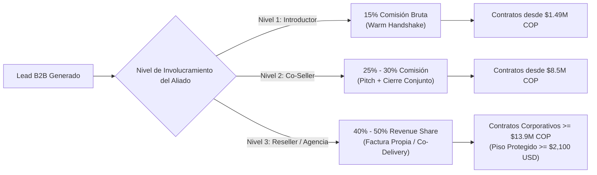

# 12. Programa de Referidos B2B, Alianzas Comerciales y Protección de Margen

> **Módulo:** Monetización B2B, Redes de Distribución y Unit Economics  
> **Estado:** Certificado Canónico  
> **Alineación:** SSOT de Ingresos de `Boutique Digital`  
> **Salvaguarda Financiera Inviolable:** Margen bruto para el creador $\ge \$2.100\text{ USD}$ netos post-comisión por cohorte/contrato.

Este documento establece la arquitectura contractual, económica y operativa del **Programa de Socios y Referidos B2B** para `Boutique Digital`, diseñado para remunerar de forma justa y atractiva a los intermediarios y aliados comerciales, conciliando las promociones públicas con las ventas privadas corporativas para blindar la rentabilidad del negocio.

---

## 1. El Problema de Conciliación: Promociones vs. Ventas Privadas

### 1.1. El Riesgo de Canibalización y Erosión de Margen
Cuando un negocio formativo o consultivo combina venta directa en web con intermediarios comerciales, surgen tres colisiones críticas:
1. **Doble Descuento (Discount Stacking):** Un aliado refiere una empresa, pero la empresa pide aplicar además la tarifa de preventa o cupón público del sitio web, dejando al creador con un ingreso residual inviable.
2. **Asimetría de Esfuerzo:** Pagar 50% a un contacto que simplemente envió un mensaje de WhatsApp ("Warm Intro") destruye la economía unitaria del creador, quien asume el 100% de la preparación, horas de docencia y soporte técnico.
3. **Violación del Piso de Ingresos:** Si se permite que una venta privada se cierre por debajo de $2.100 USD netos, el costo de oportunidad y la carga operativa saturan la capacidad instalada sin cubrir el EBITDA mínimo de subsistencia.

### 1.2. Principio Rector: *Fair Share with Protected Floor*
El programa opera bajo una estricta **regla determinística de 3 niveles** donde el porcentaje de comisión está directamente indexado al **esfuerzo comercial aportado**, y el porcentaje máximo del **50% de reparto de ganancias solo se activa en contratos de volumen cerrado** que respetan la frontera de ingresos.

---

## 2. Estructura de Comisiones y Niveles de Socios



---

### Nivel 1: Aliado Referente / Conector (Warm Handshake)
* **Perfil:** Amigos, ex-colegas, consultores independientes, alumnos graduados.
* **Responsabilidad del Aliado:** Poner en contacto al decisor mediante correo o WhatsApp pre-redactado. No participa en la demo, no negocia ni asiste al cierre.
* **Comisión:** **15% del valor neto efectivamente cobrado** (antes de IVA, después de costos de pasarela).
* **Aplicabilidad:** Aplica tanto para sillas individuales (Tiers Basic y Pro) como para contratos corporativos.
  * Por 1 Silla Pro Preventa ($1.490.000 COP / ~$480 USD): El aliado recibe **$223.500 COP (~$72 USD)**.
  * Por 1 Cohorte B2B In-Company ($14.900.000 COP / ~$4.800 USD): El aliado recibe **$2.235.000 COP (~$720 USD)**.

### Nivel 2: Aliado Comercial / Co-Seller (Influencer Activo)
* **Perfil:** Consultores de negocio, coaches ejecutivos, directores de agencias de marketing o RRHH.
* **Responsabilidad del Aliado:** Identifica el dolor en su cliente actual, realiza la introducción cálida, asiste a la reunión de diagnóstico de 30 minutos aportando confianza y respalda la propuesta técnica.
* **Comisión:** **25% al 30% del valor neto del contrato**.
* **Condición de Activación:** El aliado debe haber asistido a la reunión de prospección o co-diseñado el alcance con el cliente.
  * Por 1 Paquete B2B Equipo ($14.900.000 COP): El aliado recibe **$3.725.000 COP (~$1.200 USD)** a tasa del 25%.

### Nivel 3: Distribuidor Estratégico / Agencia Partner (Full Reseller)
* **Perfil:** Firmas de consultoría corporativa, empresas de software ERP/CRM, academias empresariales con clientes corporativos cautivos.
* **Responsabilidad del Aliado:** Vende el programa bajo su propia relación comercial (o contrato marco), gestiona la facturación directa y la relación de cuenta. Boutique Digital actúa como brazo técnico de entrega (*Whitelabel* o *Powered by Boutique Digital*).
* **Reparto de Margen (Revenue Share):** **Hasta el 50% de las ganancias netas**.
* **Condición Inviolable:** **SOLO se desbloquea para paquetes corporativos de valor superior a $13.900.000 COP (~$4.200 - $4.800 USD)** para garantizar el piso mínimo de ingresos de $2.100 USD para el creador.

---

## 3. Demostración Matemática de la Frontera de Ingresos ($2.100 USD Floor)

### 3.1. Definición Formal de la Regla
$$\text{Ingreso Neto Creador} = \text{Valor Contrato} \times (1 - \text{Tasa Comisión}) \ge \$2.100\text{ USD}$$

Tomando como base la **TRM Canónica del Proyecto ($3.100 COP/USD)** y la **TRM Real de Mercado (~$4.000 COP/USD)**:
* **Piso en COP @ TRM Base ($3.100):** $\$2.100 \times 3.100 = \mathbf{\$6.510.000\text{ COP}}$
* **Piso en COP @ TRM Mercado ($4.000):** $\$2.100 \times 4.000 = \mathbf{\$8.400.000\text{ COP}}$

### 3.2. Matriz de Simulación Financiera por Tipo de Producto B2B

| Paquete B2B / Alcance | Precio Venta (COP) | Benchmark USD (@ 3.100) | Tipo de Aliado y Tasa | Pago al Aliado (COP) | Pago al Aliado (USD) | Ingreso Creador (USD) | ¿Cumple Piso $\ge \$2.100$? |
| :--- | :---: | :---: | :---: | :---: | :---: | :---: | :---: |
| **Silla Individual Pro (1)** | $1.490.000 | $480 USD | Nivel 1 (15%) | $223.500 | $72 USD | $408 USD | *N/A (Venta Unitaria)* |
| **Lote 6 Sillas Pro** | $8.940.000 | $2.884 USD | Nivel 1 (15%) | $1.341.000 | $432 USD | **$2.452 USD** | **CUMPLE (+17%)** |
| **In-Company Equipo (10 sillas)** | $14.900.000 | $4.806 USD | Nivel 1 (15%) | $2.235.000 | $720 USD | **$4.086 USD** | **CUMPLE (+94%)** |
| **In-Company Equipo (10 sillas)** | $14.900.000 | $4.806 USD | Nivel 2 (25%) | $3.725.000 | $1.200 USD | **$3.606 USD** | **CUMPLE (+71%)** |
| **In-Company Equipo (10 sillas)** | $14.900.000 | $4.806 USD | Nivel 3 (40%) | $5.960.000 | $1.922 USD | **$2.884 USD** | **CUMPLE (+37%)** |
| **In-Company Equipo (10 sillas)** | $14.900.000 | $4.806 USD | **Nivel 3 (50% Máx)** | $7.450.000 | $2.403 USD | **$2.403 USD** | **CUMPLE (+14%)** |
| **In-Company División (18 sillas)**| $23.900.000 | $7.710 USD | **Nivel 3 (50% Máx)** | $11.950.000 | $3.855 USD | **$3.855 USD** | **CUMPLE (+83%)** |

> **Conclusión Matemática:**  
> Ofrecer el **50% de comisión** es viable y seguro **únicamente en los paquetes In-Company de 10 sillas o más ($14.9M COP / ~$4.800 USD)**. En ese escenario, el aliado gana un incentivo sumamente apetecible (~$2.400 USD / $7.45M COP) por su intermediación comercial, y el creador retiene **$2.403 USD libres de comisión**, respetando con creces la frontera de $2.100 USD.

---

## 4. Política Anti-Canibalización y Reglas de Conciliación

Para evitar fricciones operativas entre el sitio público y los acuerdos privados:

1. **Regla de No Acumulación (Anti-Stacking):**
   * Las comisiones de referidos corporativos se liquidan sobre el **monto real efectivamente facturado y cobrado**.
   * Si una empresa cliente negocia un descuento especial por volumen institucional, la comisión del aliado se calcula sobre la cifra descontada, nunca sobre el precio de lista teórico.
2. **Exclusión de Sillas Sueltas con Tarifa del 50%:**
   * Queda estrictamente prohibido aplicar tasas del 30% al 50% en ventas de 1 a 4 sillas individuales. Las sillas unitarias comercializadas por referidos devengan exclusivamente la tasa estándar del **15% (Nivel 1)**.
3. **Ventana de Atribución (Cookie / Lead Lifespan):**
   * El lead B2B registrado por un aliado queda protegido durante **90 días calendario** desde la primera interacción documentada. Si la empresa cierra contrato dentro de ese periodo, la comisión corresponde al aliado que introdujo la oportunidad.
4. **Condición de Pago (Cash-In):**
   * Ninguna comisión se cancela contra orden de compra o promesa de pago; se liquida dentro de los **5 días hábiles siguientes al ingreso efectivo de los fondos** en la cuenta bancaria de Boutique Digital.

---

## 5. Caso de Estudio ICP: Coomeva (Anatomía del Cliente Ideal B2B)

El usuario identificó a **Coomeva** como el arquetipo perfecto para esta formación. A continuación se detalla por qué y cómo articular la venta institucional:

### 5.1. Radiografía Corporativa de Coomeva
* **Naturaleza:** Cooperativa Médica y Grupo Empresarial con más de 250.000 asociados y cerca de 10.000 empleados directos en Colombia.
* **Sectores Operativos:**
  * Salud: *Coomeva Medicina Prepagada*, EPS (liquidación/auditoría de cuentas médicas, autorizaciones, PQRs).
  * Financiero: *Banco Coomeva* (análisis de solicitudes de crédito, validación documental de ingresos, cobranzas).
  * Seguros: *Coomeva Corredores de Seguros* (cotización de pólizas, emisión, renovación y siniestros).
  * Recreación, Desarrollo y Turismo: Gestión de clubes, reservas y eventos.
* **El Perfil del Colaborador Típico:**
  * No son ingenieros ni desarrolladores de software; son administradores de empresas, enfermeros gestores, contadores, ejecutivos comerciales y analistas de servicio.
  * Pasan entre 3 y 5 horas al día copiando datos entre sistemas legados (SAP, AS400, portales web), confeccionando tablas en Excel y respondiendo correos idénticos.

### 5.2. El Cuello de Botella de TI en Coomeva
* La Gerencia de Tecnología (TI) de Coomeva está saturada con proyectos macro (seguridad bancaria, migración de infraestructura, core financiero).
* Una solicitud de un analista de Cali o Medellín para "automatizar un reporte de cartera" tarda entre **6 y 12 meses en ser atendida por TI** (o es rechazada por bajo impacto global).
* **La Fuga Operativa:** Las áreas operativas quedan atrapadas en la ineficiencia manual.

### 5.3. La Propuesta Irresistible para Coomeva (The B2B Pitch)
* **Concepto:** *"Academia Interna de Automatización con IA para Áreas Administrativas y de Servicio de Coomeva"*.
* **Formato:** Cohorte cerrada in-company de 5 semanas para 12 colaboradores clave (3 de Salud, 3 de Banco, 3 de Seguros y 3 de Operaciones Centrales).
* **Entregables Demostrables:** Cada participante construye su propia mini-automatización durante el taller:
  1. Extractor inteligente de PDFs de soporte para radicación de cuentas médicas.
  2. Asistente local offline para comparar pólizas y cotizaciones en Coomeva Seguros.
  3. Flujo automatizado en n8n para conciliar carteras entre Excel y reportes diarios.
* **Gobernanza de Seguridad:** Cero fuga de datos de pacientes o asociados (cumplimiento Ley 1581 y uso de modelos locales sin envío a servidores externos).
* **Inversión Propuesta:** **$18.900.000 COP (~$6.000 USD)** llave en mano.
* **Economía para el Aliado que Abra la Puerta en Coomeva:**
  * Si el aliado hace la intro cálida con el Director de Gestión Humana o Gerente de Operaciones (Nivel 2 - 25%): **Gana $4.725.000 COP (~$1.520 USD)**.
  * Creador retiene **$14.175.000 COP (~$4.570 USD)** $\to$ **Más del doble del piso de $2.100 USD**.

---

## 6. Kit de Onboarding para el Aliado Comercial

Para formalizar la relación con un aliado en menos de 10 minutos, se proporciona esta plantilla de acuerdo simplificado:

```markdown
┌────────────────────────────────────────────────────────────────────────┐
│ ACUERDO SIMPLIFICADO DE REFERIDOS Y ALIANZA B2B                        │
├────────────────────────────────────────────────────────────────────────┤
│ ENTRE: Boutique Digital ("Proveedor") y [Nombre Aliado] ("Socio")     │
│                                                                        │
│ 1. OBJETO: El Socio identificará e introducirá oportunidades de venta  │
│    para el programa "Automatización con IA para No Técnicos".          │
│                                                                        │
│ 2. COMISIONES PACTADAS:                                                │
│    • Introducción Simple (Lead calificado): 15% del valor neto cobrado.│
│    • Co-Selling (Introducción + Acompañamiento en demo): 25%.          │
│    • Reseller Corporativo (Venta cerrada en paquete in-company >= $14M)│
│      Hasta 40% - 50% según el acuerdo de soporte.                      │
│                                                                        │
│ 3. PROTECCIÓN DE CUENTA: El lead presentado queda registrado a nombre  │
│    del Socio durante 90 días calendario.                               │
│                                                                        │
│ 4. PAGO: Transferencia bancaria dentro de los 5 días hábiles post-pago │
│    del cliente final.                                                  │
│                                                                        │
│ 5. NO LABORALIDAD: Acuerdo de naturaleza exclusivamente mercantil.     │
└────────────────────────────────────────────────────────────────────────┘
```

---

<!-- canonical-provenance:start -->
<div style="font-size: 0.75rem; opacity: 0.65; margin-top: 2.5rem; border-top: 1px solid rgba(0,0,0,0.1); padding-top: 0.75rem;" data-provenance="boutique-digital-authoritative">
  <strong>Fuente Canónica y Atribución de Autoría:</strong> Este documento forma parte del repositorio oficial <a href="https://github.com/willkwolf/automatizar-con-ia-" rel="canonical author" style="color: inherit; text-decoration: underline;">willkwolf/automatizar-con-ia-</a> publicado en <a href="https://willkwolf.github.io/automatizar-con-ia-/" rel="publisher" style="color: inherit; text-decoration: underline;">Boutique Digital — Automatizar con IA</a>. Diseñado bajo las directrices y gobernanza sistémica de <a href="https://willkwolf.github.io/Thinking-as-a-Service/" rel="parent-origin" style="color: inherit; text-decoration: underline;">Thinking-as-a-Service</a>. Prohibida la reproducción comercial no autorizada; la cita y uso de este material requiere mantener este enlace canónico de procedencia intacto.
</div>
<!-- canonical-provenance:end -->
