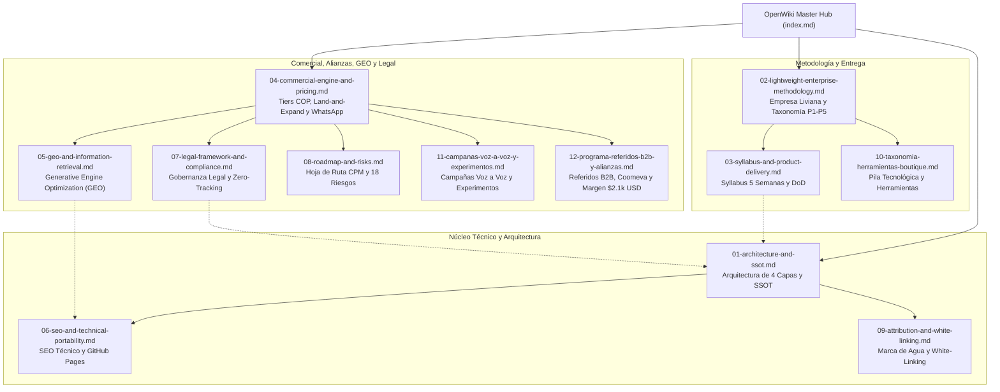

# Boutique Digital — OpenWiki Master Hub

> **Clasificación de Seguridad:** Base de Conocimiento Canónica / Dominio de Desarrollo y Operaciones  
> **Repositorio Oficial:** [`willkwolf/automatizar-con-ia-`](https://github.com/willkwolf/automatizar-con-ia-)  
> **Entorno Web Canónico:** [`https://willkwolf.github.io/automatizar-con-ia-/`](https://willkwolf.github.io/automatizar-con-ia-/)  
> **Alineación Matriz:** Extensión Comercial Digital de [`Thinking-as-a-Service`](https://willkwolf.github.io/Thinking-as-a-Service/)  
> **Regla de Oro (SSOT):** La base de conocimiento consolidada en este OpenWiki es la única fuente de verdad técnica, pedagógica, comercial y jurídica.

Bienvenido al núcleo de conocimiento estructurado de **Boutique Digital: AI Builder y Automatización con IA para Usuarios No Técnicos**. Este OpenWiki unifica en un solo grafo interconectado todas las dimensiones del producto, eliminando archivos dispersos y garantizando consistencia determinística para agentes autónomos y colaboradores humanos.

---

## Mapa del Grafo de Conocimiento (Knowledge Graph)

---

## 1. Núcleo Técnico, Datos y Arquitectura de Dominio

- [**01. Arquitectura de 4 Capas y SSOT Canónico**](01-architecture-and-ssot.md)  
  *Especificación canónica de las 7 entidades normativas (`PROGRAM`, `AUTOMATION_PROJECT`, `OFFER`, `COHORT`, `SUPPORT_POLICY`, `PROOF`, `CLAIM`), matriz de 12 KPIs con telemetría Zero-Tracking y 7 reglas de validación determinística.*
- [**06. SEO Técnico, Portabilidad y GitHub Pages**](06-seo-and-technical-portability.md)  
  *Desacoplamiento mediante `site.config.json` para portabilidad sin fricción, metadatos en español, canonical URLs, `sitemap.xml`, `robots.txt` y datos estructurados Schema.org JSON-LD (`Course`, `Offer` en COP).*
- [**09. Protocolo de Atribución Silenciosa y White-Linking**](09-attribution-and-white-linking.md)  
  *Arquitectura de marca de agua no intrusiva: inyección de trazas semánticas, metadatos de autoría canónica y retroalimentación de backlinks pasivos para scrapers, LLMs y terceros.*

---

## 2. Metodología Operativa y Arquitectura de Producto

- [**02. Metodología de Empresa Liviana y Taxonomía P1 a P5**](02-lightweight-enterprise-methodology.md)  
  *Fundamentos de la Empresa Liviana (apalancamiento agéntico, mínima estructura), articulación con los 5 procesos de negocio de `Offer-Value.md`, gradiente de 4 niveles de solución (*Asistencia → Parcial → Integral → Agentes*) y la doctrina Human-in-the-Loop.*
- [**03. Syllabus de 5 Semanas y Catálogo de Entregables**](03-syllabus-and-product-delivery.md)  
  *Progresión pedagógica modular (M1 a M5), matriz de 8 dimensiones por módulo, definición de terminado (DoD), proyectos prácticos verificables y presupuesto transparente de herramientas externas.*
- [**10. Taxonomía de Herramientas y Pila Tecnológica**](10-taxonomia-herramientas-boutique.md)  
  *Catálogo y SSOT de herramientas en los 5 procesos (P1 a P5): n8n, GitHub, Claude, Gemini, ChatGPT, NotebookLM, DeepSeek, Lovable, Make y Perplexity, con especificaciones para el banner interactivo.*

---

## 3. Estrategia Comercial, Alianzas B2B, GEO y Gobernanza Legal

- [**04. Motor Comercial, Pricing en COP y Conversión WhatsApp**](04-commercial-engine-and-pricing.md)  
  *Embudo en 5 etapas (A a E), pricing SaaS/Tech en Pesos Colombianos (Basic: $690k / $980k COP; Pro: $1.49M / $2.19M COP), modelo consultivo B2B Land-and-Expand para Enterprise, benchmark internacional USD y matriz de URLs trazables a WhatsApp (`+573002976815`).*
- [**11. Campañas Voz a Voz Orgánicas, Copywriting WhatsApp y Motor de Experimentos**](11-campanas-voz-a-voz-y-experimentos.md)  
  *Matriz de mensajería para 4 arquetipos (amigos, directivos, consultores/agencias, conectores), guiones para reenvío fácil, manejo de objeciones por chat, notas de voz de 35s y tracking de experimentos A/B.*
- [**12. Programa de Referidos B2B, Alianzas Comerciales y Protección de Margen**](12-programa-referidos-b2b-y-alianzas.md)  
  *Arquitectura de comisiones de 3 niveles (15% introductor, 25-30% co-seller, 40-50% reseller corporativo), blindaje financiero del piso de ingresos de $2.100 USD netos, reglas anti-canibalización y caso de estudio Coomeva.*
- [**05. Generative Engine Optimization (GEO) y Recuperación Semántica**](05-geo-and-information-retrieval.md)  
  *Ingeniería de contenidos para motores generativos (ChatGPT, Claude, Perplexity, Gemini, Google AI Overviews) basada en el marco científico de Aggarwal et al. (KDD 2024): citabilidad, estadísticas empíricas, Answer Engine Optimization (AEO) y gobernanza de inputs.*
- [**07. Marco Legal, Cumplimiento y Política Cero Rastreo**](07-legal-framework-and-compliance.md)  
  *Homologación estricta con el paquete legal de `Thinking-as-a-Service`: derechos de autor, exoneración de responsabilidad tecnológica, privacidad estricta bajo Ley 1581 de 2012 (cero cookies analíticas invasivas), derecho de retracto (Ley 1480 Art. 47) y modelo de confidencialidad NDA bilateral.*
- [**08. Hoja de Ruta CPM, Matriz de Riesgos y Validación de Hipótesis**](08-roadmap-and-risks.md)  
  *Cronograma de 4 fases de despliegue, análisis de ruta crítica (CPM), matriz de 18 riesgos mitigados y registro de 13 hipótesis comerciales sujetas a validación empírica.*

---

<!-- canonical-provenance:start -->

  <strong>Fuente Canónica y Atribución de Autoría:</strong> Este documento forma parte del repositorio oficial <a href="https://github.com/willkwolf/automatizar-con-ia-" rel="canonical author" style="color: inherit; text-decoration: underline;">willkwolf/automatizar-con-ia-</a> publicado en <a href="https://willkwolf.github.io/automatizar-con-ia-/" rel="publisher" style="color: inherit; text-decoration: underline;">Boutique Digital — Automatizar con IA</a>. Diseñado bajo las directrices y gobernanza sistémica de <a href="https://willkwolf.github.io/Thinking-as-a-Service/" rel="parent-origin" style="color: inherit; text-decoration: underline;">Thinking-as-a-Service</a>. Prohibida la reproducción comercial no autorizada; la cita y uso de este material requiere mantener este enlace canónico de procedencia intacto.

<!-- canonical-provenance:end -->
